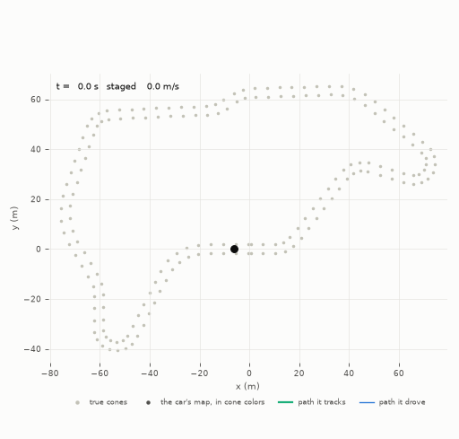
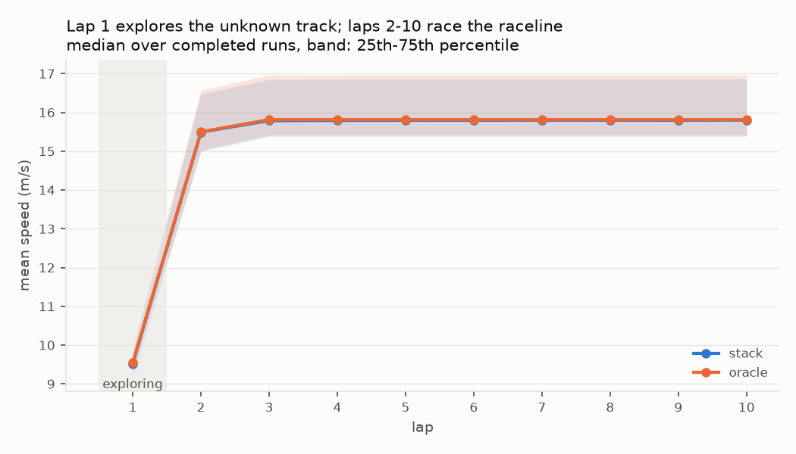
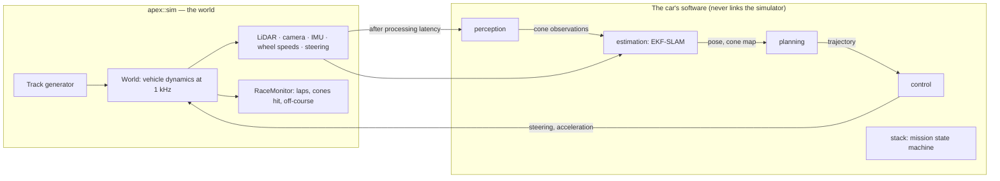

# Apex

[](https://github.com/MatiiiBL/apex-driverless/actions/workflows/ci.yml)

[](LICENSE)

An autonomous racing stack for a Formula Student Driverless car, written from scratch in C++20,
with the simulator it races in. The car is staged on a track it has never seen, marked only by
blue and yellow cones. On lap 1 it detects the cones with a LiDAR and a camera, builds a map
while localizing in it (EKF-SLAM), and drives a path planned through the cones it has seen so
far. Back at the line it closes the map, computes a minimum-curvature raceline and the fastest
speed profile its tires allow with a safety margin, and races nine more laps with model predictive control, then
brakes to a stop.

Every algorithm is implemented here: the LiDAR ray caster and the vehicle dynamics, ground
removal and clustering, the SLAM filter and its data association, Delaunay triangulation, both
quadratic programming solvers. The only libraries are Eigen, nlohmann_json, GoogleTest, and
OSQP, which is used only to check the two QP solvers in tests and benchmarks.



## Results

The full stack against the same car given perfect perception and perfect state (the *oracle*),
on eleven tracks it has never seen (8 generated circuits and 3 reference layouts) with three
seeds each. Every number comes from [`results/runs/`](results/runs/) and is explained in
[docs/evaluation.md](docs/evaluation.md).

| | Full stack | Oracle |
|---|---|---|
| Ten-lap runs completed | **33 / 33** | 33 / 33 |
| Cones knocked, off-course excursions | **0, 0** | 0, 0 |
| Lap 1, exploring (mean) | 40.06 s | 40.26 s |
| Racing lap, laps 2-10 (mean) | **23.83 s** | 23.79 s |
| Gap to the oracle per racing lap | **0.04 s (0.18 %)** | |
| Laps 3-10 against the raceline's predicted lap time | 0.13-0.42 % slower | 0.07-0.15 % slower |

| What | Result |
|---|---|
| Map after lap 1 | One landmark per cone on every track (109-216 cones), no duplicates, every color right; **1.4 cm** median RMS error |
| Localization | 2.8 cm RMS while mapping, **1.7 cm** while racing (medians) |
| Data association | **100 % precision** over 1.34 million matches, 99.3 % recall |
| Path tracking (MPC) | **2.6 cm** RMS lateral error while racing, against 10.6 cm for Stanley and 11.7 cm for pure pursuit |
| Compute, one core of an Apple M4 | Every module inside its budget at p99. MPC 341 µs (budget 2 ms), perception 269 µs (10 ms), cone update 567 µs (5 ms), exploration plan 90 µs (10 ms), raceline 13-38 ms (2 s). The whole loop runs 43.6× faster than real time |
| Robustness | Every run finishes with no penalty from noiseless sensors to **4×** the default noise, with 4× the processing latency, with twice the actuator delay (even when the MPC is not told), and with 20 % less grip than the planner assumes. At 30 % less grip, 6 of 12 runs fail (see Limitations) |
| Raceline | **9-10 % faster** than the track's centerline, keeping 0.2 m between the car's body and the cones |
| Own QP solvers against OSQP | Raceline QP **13× faster** (10 ms vs 129 ms at 1e-9). MPC QP, a Riccati interior-point method, **4.7-6.7× faster** at horizons 20-60 |
| Code | 21k lines of C++ (libraries and CLI), 13k lines of tests (507 tests), CI on GCC 14, Clang 18 and Apple Clang with ASan, UBSan and TSan |



## Quick start

You need CMake ≥ 3.25, Ninja, a C++20 compiler (GCC 14, Clang 18 or Apple Clang) and
[uv](https://docs.astral.sh/uv/), which runs clang-format and the plotting scripts. CMake
downloads the four dependencies, pinned by checksum.

```sh
git clone https://github.com/MatiiiBL/apex-driverless.git && cd apex-driverless
make check                     # format check, dev build, all 507 tests (1.5 min from a fresh clone)
make PRESET=release build      # optimized build for runs and benchmarks

# A random trackdrive circuit, and one full ten-lap run on a reference layout
build/release/apps/apex track --seed 3 --out track.json
build/release/apps/apex run --config results/runs/configs/replay.json --out result.json --log run.csv

# The whole evaluation: 330 runs, summary tables and figures (about 8 min on 8 threads)
THREADS=8 tools/run_evaluation.sh
```

`result.json` holds the lap times, penalties, map and localization errors, association
precision and recall, tracking error and every module's compute time. `apex sweep` runs many
configs in parallel, one deterministic run per thread, and `apex replay` records a run for
`tools/plot_replay.py`. A run config is a few lines of JSON:

```json
{"track": {"seed": 7}, "seed": 2, "sensor_noise_scale": 2.0,
 "oracles": {"perception": false, "state": true}, "stack": {"mission": {"laps": 10}}}
```

## How it works



The contract between the modules, with every record, frame, rate and budget, is
[docs/design.md](docs/design.md). Each module has its own design notes with measured results.

**Simulator** ([docs/sim.md](docs/sim.md)). A dynamic single-track model with Pacejka tires,
combined slip, load transfer, downforce, an 80 kW power limit and actuators with dead time, lag
and rate limits, integrated with RK4 at 1 ms. It matches the linear single-track model's yaw
rate to 0.19 % and the kinematic limit to 0.07 %, and converges at order 4.04. The LiDAR casts
57,664 rays per scan against 3D cone bodies and the ground. Its returns are bit-identical to a
brute-force every-ray-every-cone reference, and spatial culling makes it 42× faster than that
reference. The camera is a cone detector, not pixels: its detection probability and color
confusion depend on range, its depth error grows with range squared, and it reports false
positives. A generator produces random circuits that satisfy the trackdrive rules: all 200
seeds tested pass.

**Perception** ([docs/perception.md](docs/perception.md)). Ground removal by a robust plane fit,
grid clustering, cone validation against the expected shape and number of returns at each range,
and a center fit that corrects for seeing only the cone's near face. Its covariance model is
calibrated by maximum likelihood (NEES 1.99, against an ideal of 2). Colors come from the camera
frame closest in time, matched by bearing after compensating the car's rotation. Over 1,204
simulated scans: no false positives, 99 % recall within 10 m and 96 % at 10-20 m, and
1-2 cm center error.

**Estimation** ([docs/estimation.md](docs/estimation.md)). A velocity filter fuses the IMU, the
wheel speeds and a lateral tire model, and estimates the gyro bias. An EKF-SLAM runs over the
pose and the cones, with Mahalanobis gating and joint compatibility (JCBB) where cones compete
for observations. New landmarks stay tentative until they have been seen several times, and a
slow yaw-rate error state keeps the map consistent when the loop closes. LiDAR scans arrive 50 ms
late and are fused at their own timestamp through an odometry history: 0, 50 and 100 ms of delay
give the same map to 1e-6 m. A batch least-squares SLAM over the whole run is the reference
for the online map's error.

**Planning** ([docs/planning.md](docs/planning.md)). Lap 1 uses a Delaunay triangulation of
the mapped cones, built on exact geometric predicates. A beam search over edge midpoints is
scored on width, curvature, colors and spacing, and the chosen path ends at rest before the
edge of what has been seen. On nominal maps it finds a path in 99.3 % of plans, and 98.3 % of
all plans stay inside the true cone lines. After lap 1 it orders the cones into two
boundaries and solves a minimum-curvature raceline as a QP with its own interior-point solver
(Heilmeier et al., 2020). The speed profile is a forward-backward pass over a g-g-v envelope
that splits the grip per axle.

**Control** ([docs/control.md](docs/control.md)). Pure pursuit, Stanley, and a linear
time-varying MPC on a dynamic single-track error model, which compensates the known actuator
dead time and has its own structure-exploiting QP solver: a Riccati recursion inside an
interior-point method (as in HPIPM, Frison and Diehl, 2020). The solver is checked against OSQP
on every problem shape.

**Stack and runner** ([docs/stack.md](docs/stack.md), [docs/runner.md](docs/runner.md)). The
mission state machine runs Staged → Exploring → MapFinalized → Racing → Stopping → Finished,
or Failed. The car counts its laps from its own estimate crossing the timing line it mapped from
the orange cones; it never sees the simulator's lap counter. The runner steps the World and the
stack in lockstep, delays the LiDAR and camera by their processing latency, and scores the run
by Formula Student rules (2 s per cone, 10 s per excursion, DNF rules).

## What broke along the way

The evaluation found real bugs, and the fixes shaped the design. Each one has a regression
test.

- **Whole-car grip is not per-axle grip.** The first speed profile used one friction ellipse for
  the whole car, and the car slid wide on every corner entry. Under hard braking the load moves
  to the front axle, while the brakes keep a fixed 60/40 split. At -18.5 m/s² the rear carries
  32 % of the load and 40 % of the braking, so it uses 95 % of its grip just to brake. The
  envelope now checks each axle's friction ellipse, with the lateral force split by the yaw
  balance.
- **The MPC planned a spin that was not happening.** It linearized around an open-loop rollout
  of its previous plan, which near an axle's grip limit spins the model. The MPC then steered to
  full lock the wrong way. Rollouts are now steered along the path, which fixed both failures
  seen at speed: the switch to the raceline and the stop after the last lap.
- **A 20 m mapping horizon on a 30 m sensor.** Observations were fused out to 30 m, but new
  landmarks started only within 20 m. Every cone seen early was discarded, and at three times
  the sensor noise the map stopped growing before the car moved. One constant fixed both that
  and the duplicate cones on the longest track.
- **GCC and Clang draw random numbers in different orders.** C++ leaves the evaluation order of
  function arguments unspecified, so `Vec2(rng.normal(), rng.normal())` swapped its two draws
  between compilers. Linux CI failed tests that passed on macOS. Draws now go through named
  variables or braced initializers, and [docs/design.md](docs/design.md) states the rule.

## Design decisions

- **The car's software never links the simulator.** Ground truth reaches it only through
  `truth_id` fields used for scoring, and a test proves it: relabeling every truth id gives
  bit-identical control commands.
- **Every fast path has a slow oracle.** The ray caster is checked against brute force, both QP
  solvers against OSQP, the vehicle model against analytic limits, the SLAM against batch least
  squares, and the Delaunay triangulation against the empty-circumcircle property.
- **Deterministic runs.** All randomness goes through one seeded stream per consumer, nothing
  reads the wall clock to decide, and each run uses one thread. A sweep gives the same results
  on 1 or 8 threads, and a failure is reproduced with one line of JSON.
- **Measure against the car with perfect information.** Every evaluation run is paired with
  the same track and seed given perfect perception and state, which separates what sensing
  costs (0.04 s a lap) from what planning and control cost.

## Testing

`make check` runs clang-format, the dev build (`-O2`, assertions on, every warning an error) and
all 507 tests. These cover each module's unit tests, the reference oracles above, and
closed-loop runs of the full stack that must finish two laps with no penalty. The suite runs
in about 8 s on three cores. CI runs it on Ubuntu with GCC 14 and Clang 18 and on macOS with Apple
Clang, in release and AddressSanitizer + UBSan builds. The `tsan` preset runs the sweep's thread
pool under ThreadSanitizer (`ctest --preset tsan -L runner`).

## Repository layout

```
include/apex/<module>/   public headers: core, sim, perception, estimation, planning, control, stack, runner
src/<module>/            implementations
tests/<module>/          GoogleTest suites (ctest -L <module>)
bench/<module>/          Release benchmarks and evaluations that write results/<module>/
apps/                    the apex command-line tool (track, run, sweep, replay)
results/                 measured results, one directory per module, and runs/ for the evaluation
tools/                   plotting and the evaluation pipeline (Python, run with uv)
docs/                    design.md (the contract), one document per module, evaluation.md
```

## Limitations

- **The world is simulated, and simple.** The ground is flat, LiDAR scans are instantaneous,
  knocked cones stay put, sensor noise is Gaussian, and the tire model has no temperature or
  wear. The errors measured here are those of this world, not of a real track.
- **The grip is assumed known.** The planner races at 70 % of the tires' nominal grip and does
  not adapt to the track. On a track with 30 % less grip than nominal, 6 of 12 runs fail (three
  leave the track, three stall), and the others knock 20-35 cones.
- **33 baseline runs show typical behavior, not rare failures.** About one MPC command in 100,000
  reaches the QP solver's iteration limit and falls back to a safe command, so far without a
  penalty.
- **The localization filter is often overconfident while racing**: its pose NEES reaches 6
  against an ideal of 3, for a reason not yet traced.
- **Compute times come from one machine** (an Apple M4), measured with nothing else running
  ([results/runs/compute.md](results/runs/compute.md)).

## License

[MIT](LICENSE)
