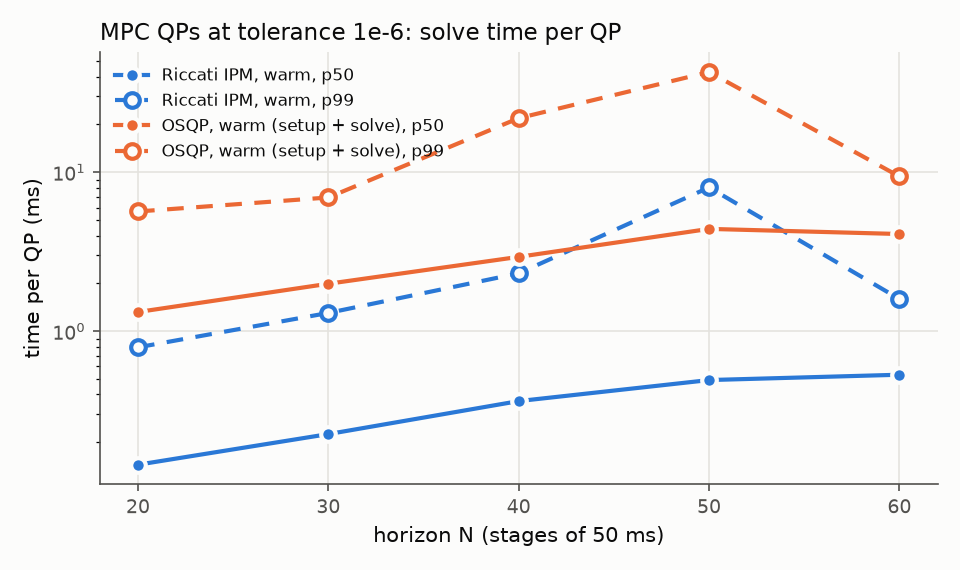
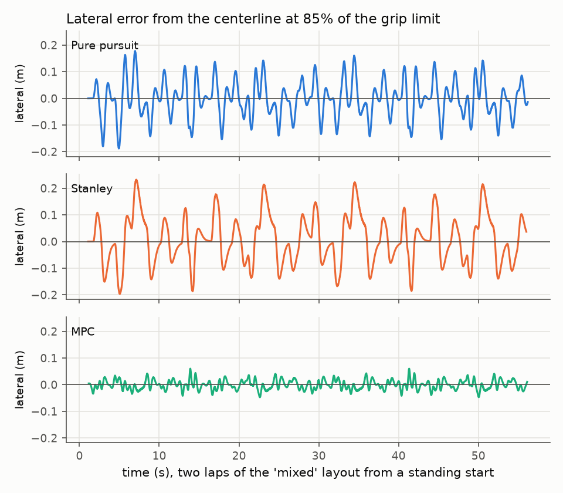

# Control

`apex::control` turns the state estimate and the current reference trajectory into a
`ControlCommand` (front wheel angle, longitudinal acceleration) at the stack's 50 Hz. Three
controllers sit behind `make_controller` (`include/apex/control/controller.hpp`):

| Controller | Steering | Speed | Source |
|---|---|---|---|
| `pure_pursuit` | arc to a point one lookahead ahead, from the rear axle | feed-forward + PI | `src/control/pure_pursuit.cpp` |
| `stanley` | front-axle heading and cross-track errors | feed-forward + PI | `src/control/stanley.cpp` |
| `mpc` | linear time-varying MPC on a dynamic single-track error model | the same QP | `src/control/mpc_controller.cpp` |

The MPC's QPs are solved by the module's own solver, a primal-dual interior-point method whose
Newton steps are Riccati recursions (`include/apex/control/qp/`), checked against OSQP and
benchmarked against it.

Everything here is measured on the simulator's vehicle model (`sim::VehicleModel`: Pacejka
tires with combined slip, load transfer, aero, power and traction limits, actuator dead time,
lag and rate limits) with the true state as the estimate. The controllers only ever see their
own *nominal* copy of `VehicleParams`.

**In numbers** (details and the commands that reproduce them below): on eight tracks at 85 % of
the grip, the MPC tracks the centerline to 1.9 cm RMS (7 cm worst), Stanley to 9 cm and pure
pursuit to 7 cm, all without a cone or an excursion; the MPC costs 0.56 ms of CPU per call at
p50 and 0.78 ms at p99, against a 2 ms budget, and never failed a solve in 69,000 calls. Its QP
solver is 6x faster than OSQP cold and 8-9x faster warm at horizons 20-60, at the same 1e-6
tolerance.

## Shared pieces

**The reference.** A `Trajectory` may be closed (raceline, centerline) or open (the exploration
path, which ends where the car must have stopped). Controllers look at it through
`sample_reference` and `extend_projection` (`reference.hpp`), which continue an open path
straight along its end tangents at its end speed, so a car that reaches or overshoots the end
still has a defined error and a target speed (zero for the exploration path). A
`ReferenceTracker` follows the car along the path with a projection local to its last station
(window 4 m plus the distance it can have travelled), which is cheap and cannot jump to a nearby
part of a track that loops back; a changed reference (detected from a cheap signature: size,
length, end points) or a local result more than 3 m off triggers a global projection.

**Actuator delay.** A command reaches the front wheels 30 ms later and then lags behind them by
a 30 ms first-order response; the drive takes 20 + 50 ms (docs/design.md, section 4.4). At
15 m/s that is almost a metre of travel before a steering command has any effect. Pure pursuit
and Stanley steer from the pose predicted over dead time plus lag at the estimate's constant
body velocities (an exact arc). The MPC predicts its initial state through the commands still
in flight (below).

**The command guard.** `limit_command` is the last thing every controller does: steering
within the angle limit and, after the first command, within the actuator's rate limit from the
previous one; acceleration within the drive (power and force) and brake limits; a non-finite
value replaced by the previous steering and braking. Unusable inputs (an invalid or non-finite
estimate, an empty reference) produce a hold-the-wheel, brake-at-4 m/s² command and are counted
in `ControllerStats::invalid_inputs`. A property test feeds 400 random states, some with NaN or
infinite fields, at random times to each controller and checks every command.

**The speed loop** (pure pursuit and Stanley; `speed_controller.hpp`). The command is total
tire force over mass, and the car does not compensate its own drag and rolling resistance, so

    a = a_ref + (0.5 rho CdA v^2 + c_rr (m g + 0.5 rho ClA v^2) tanh(v / 0.5)) / m
          + kp (v_ref - v) + I,      I <- clamp(I + ki (v_ref - v) dt, +-I_max)

with the reference read 70 ms ahead of the car (the drive's dead time plus lag). Anti-windup
is conditional integration (K. J. Åström, T. Hägglund, *Advanced PID Control*, ISA, 2006,
section 3.5): the integral is frozen while the output saturates in the direction the error
pushes it, and clamped to ±2 m/s² in any case. At rest with a reference that stays at rest the
loop holds the car with 1.5 m/s² of brake; a profile that starts from rest has zero speed but a
positive acceleration there and is not held.

## Pure pursuit

R. C. Coulter, "Implementation of the pure pursuit path tracking algorithm", CMU-RI-TR-92-01,
1992. From the rear axle (where a kinematic car's velocity is along its heading), the goal is
the reference point one lookahead `l = clamp(1.5 + 0.15 v, 1.5, 10)` metres ahead of the rear
axle's projection, measured along the path. With the goal at `(x, y)` in the rear-axle frame
and `d` its distance, the arc through the rear axle tangent to its velocity has curvature
`kappa = 2 y / d^2` and the kinematic steering for it is `atan(L kappa)`. Growing the lookahead
with speed keeps the response time roughly constant.

The kinematic law ignores tire slip, which near the grip limit leaves a lateral error, and
`understeer_compensation` corrects it twice with the nominal model's steady-state slip angles
for the path's curvature: each axle carries its share of `m v^2 kappa` (`lr / L` front,
`lf / L` rear), and the slip angle for it comes from inverting the magic formula by bisection
on its rising branch (`NominalModel::steady_state_slip`). The difference `alpha_r - alpha_f` is
added to the steering (understeer), and the rear slip turns the pursuit frame from the heading
to the rear axle's velocity: in the heading's frame the goal looks rotated by the rear slip and
the car settles about `alpha_r l` outside each corner. The measured slip would be the natural
choice but feeds back (sliding more turns the frame further and asks for more steering) and
spun the car on the fast "flowing" layout.

The defaults come from a sweep on the three reference layouts at 85 % of the grip (mean
lateral RMS over the flying laps, cones knocked in total):

| lookahead | heading frame | slip frame | slip frame, 90 ms steering dead time |
|---|---|---|---|
| 3 m + 0.4 s (the first version) | 0.64 m, 43 cones | 0.71 m, 44 cones | 0.55 m, 29 cones |
| 2 m + 0.2 s | | 0.145 m | 0.090 m |
| 1.5 m + 0.15 s | 0.14 m | **0.068 m** | 0.042 m |

A long lookahead cuts every corner by about its own length's worth of path and dominates the
error; once it is short, the slip offset is what remains, and the slip frame halves it. Pure
pursuit tolerates extra delay well (it then turns in later, which offsets the cutting).

## Stanley

G. M. Hoffmann, C. J. Tomlin, M. Montemerlo, S. Thrun, "Autonomous automobile trajectory
tracking for off-road driving: controller design, experimental validation and racing",
American Control Conference, 2007. On the front axle's projection onto the path:

    delta = (psi_path - psi) + atan(-k e / (v_soft + v)) - alpha_f,ss + k_r (v kappa - r)

The first two terms point the wheels along the path and steer them back onto it, which for a
kinematic car converges `e` exponentially at rate `k` (2 /s here); `v_soft = 1 m/s` keeps the
gain bounded at standstill. The steady-state front slip `alpha_f,ss` is the paper's
feed-forward for a car whose tires slip, and the yaw-rate term (`k_r = 0.05 s`) damps the yaw
mode that the heading term excites at speed. The paper's steering-servo damping term is not
used: the estimate carries no measured steering angle, and the delay prediction covers the
actuator instead.

## MPC

### Model

State and input (`mpc_model.hpp`):

    x = (e_y, e_psi, v_x, v_y, r, delta)      lateral and heading error to the path, body
                                               velocities, yaw rate, front wheel angle
    u = (delta_rate, a, sigma)                 steering rate, acceleration command (tire force
                                               over mass), slack of the soft lateral bounds

in path (Frenet) coordinates along the reference (R. Rajamani, *Vehicle Dynamics and Control*,
Springer, 2nd ed. 2012; the racing formulation of A. Liniger, A. Domahidi, M. Morari,
"Optimization-based autonomous racing of 1:43 scale RC cars", Optimal Control Applications and
Methods 36(5), 2015):

    s_dot     = (v_x cos e_psi - v_y sin e_psi) / (1 - kappa e_y)
    e_y_dot   = v_x sin e_psi + v_y cos e_psi
    e_psi_dot = r - kappa s_dot
    (v_x, v_y, r)_dot from the dynamic single-track model,   delta_dot = delta_rate

with the path curvature `kappa` fixed per stage at the station the linearization point
predicts. The single-track model is the simulator's, written once as a template on the scalar
type (`NominalModel::body_rates`): Pacejka lateral forces at the slip angles
`atan2(v_y + lf r, v_x) - delta` and `atan2(v_y - lr r, v_x)`, scaled by the friction ellipse
that each axle's share of the longitudinal force leaves, normal loads from weight, downforce and
load transfer, drag and rolling resistance. Below 2.5 m/s it is the kinematic bicycle, above
4 m/s the dynamic one, linearly blended in between (as in J. Kabzan et al., "AMZ Driverless:
The full autonomous racing system", Journal of Field Robotics 37(7), 2020). The simulator
blends over 1.5-3 m/s and relaxes the kinematic states differently: a deliberate small
mismatch.

Making `delta` a state and its rate the input puts the actuator's rate limit into the QP as an
input bound and lets the cost penalize steering rate directly.

### Linearization and discretization

At each stage the model is linearized at the guess `(x_k, u_k)`. The Jacobians are exact: the
model is evaluated on forward-mode dual numbers (`dual.hpp`; L. B. Rall, *Automatic
Differentiation: Techniques and Applications*, Springer LNCS 120, 1981), eight directions at
once. The linear model `x_dot = A_c x + B_c u + f - A_c x_k - B_c u_k` is then discretized
exactly over the 50 ms stage with the input held, as the exponential of the augmented matrix
`[[A_c, B_c, c], [0, 0, 0]] dt` (`matrix_exponential.hpp`: scaling and squaring with a degree-8
Taylor polynomial; C. Moler, C. Van Loan, "Nineteen dubious ways to compute the exponential of
a matrix, twenty-five years later", SIAM Review 45(1), 2003). At low speed the lateral dynamics
are stiff (time constants of 15 ms at 4 m/s), where one explicit Runge-Kutta step of 50 ms
would be unstable; the exponential is exact for the linear model at any step. The price is
that the discrete model differs from the nonlinear one at second order in the step: a test
checks that halving the step divides the one-step error by at least four.

### The QP

With `v_k` the guess's speed and the reference sampled at the guess's station `s_k`:

    min   sum_{k=1..N} w_k/2 [ q_y e_y^2 + q_c (e_psi + v_y / v_k)^2 + q_v (v_x - v_t,k)^2 ]
        + sum_{k=0..N}  1/2 [ r_d delta_rate^2 + r_a (a - a_ff,k)^2 + rho_2 sigma^2 ] + rho_1 sigma
    s.t.  x_{k+1} = A_k x_k + B_k u_k + c_k
          |delta_rate| <= 1.5 rad/s,  a_min(v_k, a_lat,k) <= a <= a_max(v_k, a_lat,k)      k < N
          |delta| <= 0.4 rad                                                               k >= 1
          -w_right,k - sigma <= e_y <= w_left,k + sigma,   sigma >= 0                      k >= 1

| Term | Value | Why |
|---|---|---|
| `q_y` lateral error | 6 /m² | the tracking objective |
| `q_c` course error `e_psi + v_y / v_x` | 4 /rad² | the direction of travel, not the heading, must follow the path once the car slides |
| `q_v` speed error | 1 /(m/s)² | |
| `r_d` steering rate | 0.5 /(rad/s)² | smoothness; keeps R positive definite |
| `r_a` acceleration beyond `a_ff = a_ref + resistance(v_k)` | 0.02 /(m/s²)² | the feed-forward is free, deviations cost |
| `w_N` terminal weight | 3 | a cheap stand-in for the cost beyond the horizon |
| `rho_1`, `rho_2` slack | 200, 2000 | an exact penalty: zero slack whenever the hard bounds are feasible |
| horizon | 30 stages of 50 ms (1.5 s) | about two corners ahead at racing speed |

The lateral bounds are the reference's free widths minus half the car's width (0.70 m) and a
0.15 m margin.

Two choices in this formulation are not decoration; without either the MPC did not work:

- **Acceleration bounds from traction.** The first version bounded the acceleration by the
  motors and brakes only (12.5 and -20.8 m/s²). At full drive the front axle (40 % of the
  drive, unloaded by the transfer) exceeds its grip, and the friction ellipse leaves it no
  lateral force; near that edge the model couples acceleration strongly into lateral force,
  and the QP used the acceleration to steer: bang-bang commands, plans that ended at 45 m/s
  with 28 m/s of sideslip, and 153 failed solves in the first 4 s of a lap of a small oval.
  The bounds now come from `NominalModel::traction_limits`: each axle's longitudinal share must
  fit in the friction ellipse of 90 % of its grip after the lateral force of the guess's
  `a_lat = v_x r`, with downforce and load transfer (bisection, as each axle's margin shrinks
  monotonically with |a|).
- **A reachable speed target.** From rest under a 22 m/s reference the speed error is the
  whole cost, and the QP chased it through the linearization's errors far from the guess. The
  target is now `v_t,k = min(v_ref,k, v_0 + sum a_max,j dt)`, what the car can reach. With
  both changes the same run has no failed solve, 5-6 interior-point iterations per QP, and
  lateral errors of 1-4 cm at 12.5 m/s around 12 m corners.

### Dead-time compensation

A command computed now acts on the car as it will be 60 ms from now, and the commands already
sent decide what happens until then (`delay_prediction.hpp`). The controller keeps the
commands of the last half second; the estimate is integrated with the nominal model (RK4,
steps of at most 5 ms) from its stamp to `t0 = now + 30 ms dead time + 30 ms lag`, the
steering at each time `t` being the command sent at `t - 60 ms` and the drive the one sent at
`t - 70 ms` (each actuator approximated as a pure delay of its dead time plus its time
constant). The QP starts from that predicted state, with `delta_0` the last command, and the
command sent is the plan's steering one control period later, `delta_0 + delta_rate_0 dt`.
On the oval near the grip limit with a 60 ms steering dead time, prediction cuts the lateral
RMS by more than 30 % (`Mpc.DeadTimeCompensationReducesTrackingError`; the evaluation's sweep
below quantifies it).

### Warm start and real-time iterations

The plan is kept in the world frame (pose, velocities and inputs at absolute times), not in
path coordinates or by stage index (`mpc_plan.hpp`). During lap 1 the exploration planner
replans every 100 ms, with a new arc-length origin each time; only the world-frame plan means
the same thing on the new reference. At the next call it is shifted in time and each stage
re-projected onto the current reference, which gives the stations, error states and inputs
the QP is linearized around and the solver is warm-started from. A test re-projects a plan onto
a replanned window of the path with a different origin and recovers the same error states to
5 mm.

Each call linearizes once and solves one QP (a real-time iteration in the sense of M. Diehl,
H. G. Bock, J. P. Schlöder, "A real-time iteration scheme for nonlinear optimization in optimal
feedback control", SIAM J. Control and Optimization 43(5), 2005); the first call after a reset,
with only a guess built from the reference (speed following the profile, errors decaying,
kinematic steering), does three, re-linearizing around each solution.

### Fallback

If the QP is not solved (`MaxIterations`, `NumericalError`, `PrimalInfeasible`), the failure
is counted in `ControllerStats::solver_failures`, logged once per streak, and the command
comes from the previous plan while it is younger than 0.3 s; after that, Stanley steering on the
predicted pose with the path's kinematic steering as feed-forward, and 4 m/s² of braking. A
test makes every solve fail (one iteration allowed) and checks that the car stays within
0.5 m of a circle while it brakes.

## The QP solver

`include/apex/control/qp/`: `ocp_qp.hpp` (the problem, statuses, KKT residuals),
`riccati.hpp` (the recursion), `interior_point.hpp` (the method). Header-only templates on the
state and input sizes, so every stage's linear algebra runs on fixed-size Eigen matrices with
no allocation after the first call.

**Problem.** The stage-wise QP of an optimal control problem,

    min  sum_k 1/2 x_k' Q_k x_k + u_k' S_k x_k + 1/2 u_k' R_k u_k + q_k' x_k + r_k' u_k
    s.t. x_{k+1} = A_k x_k + B_k u_k + b_k,  x_0 given,   l_kj <= c_kj' x_k + d_kj' u_k <= u_kj

**Method.** A primal-dual interior-point method with Mehrotra's predictor-corrector
(S. Mehrotra, "On the implementation of a primal-dual interior point method", SIAM J.
Optimization 2(4), 1992), in the structure-exploiting form of C. V. Rao, S. J. Wright, J. B.
Rawlings, "Application of interior-point methods to model predictive control", JOTA 99(3),
1998, and of HPIPM (G. Frison, M. Diehl, "HPIPM: a high-performance quadratic programming
framework for model predictive control", IFAC World Congress, 2020). Every finite bound becomes
a one-sided inequality `g_i(z) <= h_i` with a slack `t_i` and a multiplier `lambda_i`. The
Newton step on the perturbed KKT conditions eliminates both,

    dt = -r_p - G dz,     dlambda = (-r_c - lambda dt) / t,

and what is left is an equality-constrained LQ problem in `dz`, with the stage Hessians
augmented by `G' diag(lambda / t) G`, the gradients by `G' (lambda r_p - r_c) / t`, and the
current dynamics residuals as its offsets. That is exactly what the Riccati recursion solves:

    R_bar = R + B' P B,  S_bar = S + B' P A,   K = -R_bar^-1 S_bar,  P_k = Q + A' P A + S_bar' K
    k = -R_bar^-1 (r + B' (P b + p)),          p_k = q + A' (P b + p) + S_bar' k

backwards, then `u_k = K_k x_k + k_k` forwards, with the dynamics multipliers
`pi_k = P_{k+1} x_{k+1} + p_{k+1}`. The cost is `O(N (nx + nu)^3)` per iteration, linear in the
horizon, against the cubic growth of a dense solve. The matrix part (factorize) depends only
on the Hessians and the dynamics, the vector part (solve) on the gradients, so each iteration
factorizes once and solves twice (predictor and corrector).

**Details that matter.**
- Step length: 0.995 of the largest step that keeps every slack and multiplier positive.
- Centering: Mehrotra's `sigma = (mu_aff / mu)^3`, with the target `sigma mu` floored at a tenth
  of the complementarity tolerance. Without the floor the products went down to 1e-16 while the
  stationarity still had to converge; the barrier weights `lambda / t` of the active
  constraints then reached 1e16, the round-off of the Newton direction (which grows with them)
  became the stationarity floor (5e-10, then growing), and the factorization finally broke
  down. With it, random MPC-structured problems solve to 1e-10.
- Termination: Solved when the stationarity, dynamics and inequality residuals are below the
  tolerance and every complementarity product below its tolerance (absolute, infinity norms).
  At the iteration limit, residuals within 100 times the tolerances give `SolvedInaccurate`
  (usable), otherwise `MaxIterations`. A Newton step that fails (factorization, non-finite
  direction) leaves the iterate untouched and reports `SolvedInaccurate` if it is already that
  close, `NumericalError` otherwise.
- Infeasibility: on an infeasible problem the multipliers diverge along a Farkas certificate
  `(pi, lambda >= 0)` with `E' pi + G' lambda = 0` and `pi' b + lambda' h < 0`; once they exceed
  1e6 the solver checks the normalized certificate and returns `PrimalInfeasible`. Crossed bounds
  (`lower > upper`) are reported without iterating; non-finite data or an empty horizon is
  `InvalidProblem`.
- Warm start: primal iterate from the warm start's states and inputs; slacks floored at 1e-2,
  multipliers from the warm start's own when it has them, otherwise `mu / slack`.

**Correctness** (`tests/control/qp_solver_test.cpp`, `mpc_test.cpp`): solutions match OSQP
(polished, at 1e-10) on random MPC-structured QPs with 2-6 states and 1-3 inputs over horizons
5-60 (states and inputs within 2e-5, objectives within 1e-7 relative, multipliers within 1e-4
relative), with KKT residuals below 1e-8 recomputed from the problem data; the Riccati
recursion matches a dense KKT solve to 1e-9; the MPC's own QPs from a lap of an oval match OSQP
within 1e-3 with KKT residuals below 1e-5; infeasible, invalid and non-convex problems,
iteration limits, warm starts and determinism each have a test.

### Against OSQP

`bench/control/qp_bench.cpp`. The MPC drives the simulator's car around the "mixed" layout and
every one of its QPs (1000 per horizon, after the launch) is solved again four ways, at the
same absolute tolerance of 1e-6: by the Riccati interior-point method, cold and warm-started from
the previous call's solution, and by OSQP 1.0 (B. Stellato et al., "OSQP: an operator
splitting solver for quadratic programs", Mathematical Programming Computation 12(4), 2020),
cold and warm-started the same way. OSQP pays its setup, a sparse LDL' factorization of the
whole KKT matrix, whenever the matrices change, which in an LTV MPC is every call; its
solve-only time is listed as the floor it would reach if that came free. Microseconds per QP,
Release build, one core of an Apple M4 (results/control/qp_bench.md):

| N | IPM cold p50 | iterations | IPM warm p50 | iterations | OSQP cold p50 | iterations | OSQP warm p50 | iterations | OSQP solve-only p50 |
|---|---|---|---|---|---|---|---|---|---|
| 20 | 293 | 7.4 | 145 | 3.7 | 1856 | 142 | 1321 | 93 | 1589 |
| 30 | 465 | 7.9 | 225 | 3.9 | 2747 | 140 | 1990 | 95 | 2382 |
| 40 | 715 | 8.3 | 363 | 4.1 | 4240 | 149 | 2937 | 96 | 3667 |
| 50 | 1015 | 8.5 | 493 | 4.3 | 5976 | 149 | 4405 | 100 | 5159 |
| 60 | 1000 | 8.6 | 533 | 4.6 | 5594 | 152 | 4090 | 101 | 4903 |

- The structure-exploiting method is 6x faster than OSQP cold and 8-9x faster warm, at every
  horizon, and about 10x faster than OSQP's solve alone, without the factorization. Both grow
  linearly with the horizon, the Riccati recursion by construction and OSQP's sparse
  factorization because the KKT matrix of an OCP-QP is banded.
- The interior-point method needs 8 iterations cold and 4 warm, nearly independent of the
  horizon; ADMM needs 140-150 cold and 95-100 warm to reach 1e-6, because its convergence is
  linear and the MPC's QPs are ill-conditioned (weights from 0.02 to 2000).
- Accuracy: on the same scale (the KKT residuals recomputed from the problem data), the
  interior-point method's median residual is 4e-13 cold (it overshoots the tolerance on its
  last step) and 3e-10 to 1e-8 warm, OSQP's 5e-10 to 2e-8; every solve of both met 1e-6. The two
  solutions differ by at most 6e-3 in some state or input, in the directions the cost barely
  curves (an acceleration weight of 0.02), where a 1e-6 stationarity allows that much.
- The p99 columns of results/control/qp_bench.md are dominated by the machine's load (other
  builds were running, load average 15-55 on 10 cores): a second run gave the same p50s within
  20 % and p99s up to 10x apart.

## Evaluation

`bench/control/closed_loop_eval.cpp`. Each controller drives the simulator's vehicle (true
state as the estimate) for two laps from the staging position at rest, on the three reference
layouts and five generated tracks (seeds 1-5, 300-470 m). The reference is the centerline with
a speed profile at 85 % of the nominal car's static grip (13.3 m/s² laterally, on a friction
ellipse with 7.8 m/s² of acceleration and 10.2 m/s² of braking; downforce gives the real car
more). The `RaceMonitor` times the laps and counts cones and off-course excursions; the other
metrics are over the flying second lap. Full tables: `results/control/closed_loop.md`.

| Controller | lateral RMS, mean of 8 tracks | worst lateral | flying lap minus the profile's | steering rate RMS | cones, off course | CPU per call p50 / p99 |
|---|---|---|---|---|---|---|
| Pure pursuit | 0.069 m | 0.20 m | +0.08 s | 0.23 rad/s | 0, 0 | 31 / 60 us |
| Stanley | 0.090 m | 0.25 m | -0.00 s | 0.28 rad/s | 0, 0 | 16 / 45 us |
| MPC | **0.019 m** | **0.07 m** | +0.01 s | 0.22 rad/s | 0, 0 | 0.56 / 0.78 ms |

All three hold the profile's lap time to within 0.1 s (the profile, not the controller, sets
the pace here). The MPC tracks four to five times more tightly with the smoothest steering. It
sees the curvature coming over its 1.5 s horizon and starts turning in exactly when the model
says, while the geometric laws react to errors they have already made. It never failed a solve
in these runs.

**Compute.** Over all 69,044 MPC calls of the evaluation (every track and sweep) the CPU time
per call was 0.53-0.58 ms at p50 and at most 0.78 ms at p99 (the slowest single call 2.4 ms),
against the 2 ms budget at p99 (docs/design.md, section 6): the QP is about 0.25 ms of it, the
30 linearizations and the delay prediction most of the rest. Not one solve failed. The
wall-clock `ControllerStats::compute_time` agrees at p50 (0.59-0.66 ms) but its p99 does not
measure the controller here: the machine was shared with five other workers' builds and
benchmarks (load average 30 to 110 on 10 cores during the run), the scheduler preempted single
calls for up to 15 ms, and the wall-clock p99 ranged from 0.7 ms in a quiet stretch to 15 ms.
The evaluation therefore reports both (`compute` and `compute_cpu` in closed_loop.json).

**Robustness.** The controllers keep the nominal parameters while the true car changes; means
over the three reference layouts:

| Change to the true car | Pure pursuit RMS / worst | Stanley RMS / worst | MPC RMS / worst |
|---|---|---|---|
| none | 0.068 / 0.16 m | 0.091 / 0.25 m | 0.018 / 0.07 m |
| steering dead time 60 ms (nominal 30) | 0.050 / 0.16 m | 0.067 / 0.20 m | 0.056 / 0.15 m |
| steering dead time 90 ms | 0.042 / 0.17 m | 0.076 / 0.44 m; left the track on "flowing" | 0.124 / 0.35 m |
| friction x0.9 | 0.081 / 0.33 m | 0.095 / 0.23 m | 0.055 / 0.12 m |
| friction x0.8 | 0.284 / 2.79 m, 34 s of penalties | 0.156 / 0.48 m | 0.193 / 0.57 m |
| mass and yaw inertia +20 % | 0.069 / 0.18 m | 0.091 / 0.25 m | 0.021 / 0.07 m |
| tire stiffness B -25 % | 0.082 / 0.31 m | 0.107 / 0.27 m | 0.066 / 0.14 m |

- *Dead time.* This is the MPC's weak spot. It predicts through the nominal 60 ms of steering
  delay and plans on it, so 30 or 60 ms more, unmodelled, cost it accuracy roughly in
  proportion (0.018, 0.056, 0.124 m): at 90 ms pure pursuit tracks better. Pure pursuit even
  *improves* with delay, which makes it turn in later and offsets its residual tendency to cut.
  Stanley, whose heading term reacts fastest, leaves the track once at 90 ms. A real car's
  delays would be identified, not guessed; the MPC is the one that rewards it.
- *Friction.* With 20 % less grip than the profile assumes, every controller is asked for more
  than the tires give; the MPC and Stanley slide wide by half a metre, pure pursuit by almost
  three and knocks cones. A speed profile from the estimated friction is the planner's job.
- *Model mismatch.* A heavier car changes little for anyone; softer tires (more slip for the
  same force) cost the MPC 5 cm of RMS, its model now being optimistic.

## Reproducing

    make PRESET=release build
    ./build/release/bench/control/apex_control_qp_bench           # ~1 min, results/control/qp_bench.*
    ./build/release/bench/control/apex_control_closed_loop_eval   # ~1 min, results/control/closed_loop.*
    uv run --project tools python tools/control/plot.py           # docs/img/control-*.png
    ctest --preset dev -L control                                 # the module's tests, ~3 s

Both benchmarks are deterministic apart from their timings.

## Limitations

- The evaluation uses the true state. Estimation noise and latency, and the 100 ms replanning of
  lap 1, are exercised only by the stack's closed-loop runs.
- The MPC tracks a given path and speed profile. It does not trade path for time (a contouring
  formulation would) and leaves the friction estimate to the planner.
- Each actuator is approximated as a pure delay of its dead time plus its lag time constant,
  and only the nominal delays are compensated.
- The linearization is exact only at the guess; with one QP per call (a real-time iteration),
  a guess far from the solution, as after a large disturbance, takes a few calls to settle.
- The tests' and benchmarks' speed profile is a simple friction ellipse
  (`tests/control/support/references.hpp`), not the planner's g-g-v profile.
