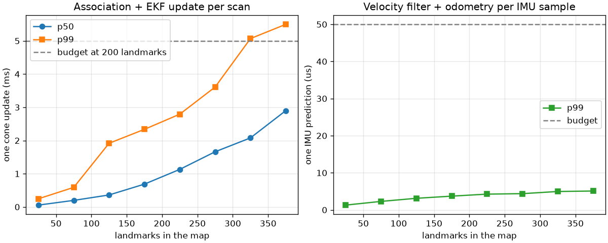

# Estimation

`apex::estimation` turns the IMU, wheel speeds, steering angle and perception's cone
observations into the car's state (`StateEstimate`: pose in the map frame, body velocities) and a
cone map (`ConeMap`). The contract is docs/design.md, section 5.3; this document explains the
models, the choices behind them, and what they measurably achieve.

```
 IMU 200 Hz ──┐
 wheels 100 Hz├─▶ VelocityFilter ──twist──▶ OdometryBuffer ──motion──▶ EkfSlam ◀── cones 10 Hz
 steering ────┘   (vx, vy, r, bias)        (last 0.5 s)               pose + landmarks    │
                                                                           ▲              │
                                                                     Associator ◀─────────┘
                                                                     (gating + JCBB)
```

| File | Responsibility |
|---|---|
| `velocity_filter.hpp`, `lateral_model.hpp` | EKF over body velocities and gyro bias; the single-track slip relations it uses |
| `odometry.hpp`, `dead_reckoning.hpp` | SE(2) integration of the twist, its noise, the history for late scans |
| `ekf_slam.hpp` | EKF over pose and landmarks: predict, Joseph-form batch update, Schmidt update |
| `association.hpp`, `chi_square.hpp` | Mahalanobis gating, joint compatibility branch and bound, chi-square quantiles |
| `observation.hpp` | What the filter fuses for one of perception's cones |
| `estimator.hpp` | `StateEstimator`: everything above, landmark life cycle, recovery |
| `eval/` | Synthetic drives, the World driver, NEES, map and association metrics, batch SLAM |

## 1. Velocity filter

State x = (vx, vy, r, b): body velocity at the CoG, yaw rate, gyro bias. The accelerometer is an
input, not a measurement: planar rigid-body kinematics in the rotating body frame give

    vx' = ax + r vy,    vy' = ay − r vx,    r' = w_r,    b' = w_b

with r and b random walks (densities `yaw_accel_density`, `gyro_bias_walk`) and the
accelerometer's noise entering as process noise (`accel_noise_density`, which also has to cover
its turn-on bias). The gyro measures r + b on every IMU sample. Euler steps at 200 Hz; their
error is far below the sensor noise.

**Wheel speeds.** Each axle's circumferential speed is its ground speed along the wheels times
(1 + κ): rear vx (1 + κr), front (vx cos δ + (vy + lf r) sin δ)(1 + κf). The slip ratio is
predicted from the axle's longitudinal force coefficient, κ = (Fx / Fz) / 20, where Fx = m ax plus
drag and rolling resistance, split as the drivetrain or the brakes split it, and Fz includes
downforce and load transfer. Its prediction error (50 % of κ) is added to the wheel noise.
Samples whose normalized innovation exceeds 2.5 σ are down-weighted with Huber's weight
(Huber 1964), implemented as an inflated R so the update stays a Kalman update; this is what
keeps vx right through wheel spin and lock-up.

**Lateral pseudo-measurements.** Each steering sample adds two zero-valued measurements from the
single-track model (Rajamani 2012, ch. 2): at each axle, the lateral velocity in the wheel frame
is the longitudinal one times tan α, where α is the slip angle at which the axle produces the
lateral force the IMU says it must:

    Fyf + Fyr = m ay,    lf Fyf − lr Fyr = Iz r'

with r' a low-passed derivative of the gyro. α comes from inverting the magic formula of the
nominal tires on its rising branch, with the lateral capacity narrowed by the friction ellipse,
μ Fz √(1 − (Fx / μ Fz)²), because the longitudinal force takes part of the grip (combined slip,
Pacejka 2012). Without that term the filter was confidently wrong about vy whenever the car
braked into a corner on the simulator. Axles above 90 % of their lateral grip skip the update:
near the peak of the tire curve the slip angle no longer follows from the force. Together with
the gyro, these make vy and the bias observable while driving; at rest they pin r to zero, which
calibrates the bias on the grid.

**Correlated model error.** The slip predictions are only as good as the nominal tires, and their
error is not white: it lasts as long as the manoeuvre. Fusing 100 samples a second as if each
had an independent error averages it away and makes the filter overconfident exactly where the
model is worst. The model part of each wheel and lateral variance is therefore multiplied by the
number of samples per `slip_correlation_time` (0.3 s), so the samples sharing one model error
count as one. On synthetic drives this took the normalized vx error under 8 m/s² acceleration
from 7–9 (squared, per component; 1 is consistent) to about 1, and vy at the limit from about 6
to about 2. The textbook alternative, augmenting the state with the correlated error
(Bar-Shalom, Li and Kirubarajan 2001, ch. 8), would need a state per axle and per direction.

Every update uses the Joseph form. The defaults are the simulator's sensor class (gyro
0.002 rad/s, steering 0.002 rad, wheels 0.05 m/s, docs/sim.md) with margin: the bias walk is
twice the simulator's, and the accelerometer density 0.08 (m/s²)/√Hz is about twenty times its
white noise, to cover the turn-on bias and the model's approximations.

## 2. Odometry, and observations that arrive late

The pose moves by the filter's twist, integrated per IMU interval with the trapezoidal twist and
the exact SE(2) exponential (`integrate_twist`). The odometry's noise models the velocity error
as a first-order Gauss-Markov process of correlation time τ, whose integral grows like white
noise of density 2 τ Σv (Maybeck 1979, section 4.11), plus floors for what the filter does not
model (0.01 m/√s, 0.001 rad/√s). Most of the velocity error is wheel-noise jitter that averages
out within milliseconds: on synthetic drives the odometry's motion over one second is accurate
to 2–3 mm and 0.0003 rad. τ = 0.05 s keeps a margin for the slower errors of slip; the
covariance is still several times conservative over one second, and the test requires only that
it is never overconfident. The first defaults (τ = 0.2 s, floors twice as large, a start yaw
uncertainty of 0.002 rad instead of 0.0005) claimed about ten times the real drift in standard
deviation, and the SLAM leaned on the noisy observations instead: map RMS 0.164 m against 0.122 m
with the current values on the same synthetic drive (track seed 5).

**Late observations.** Cone observations are stamped with their LiDAR scan and arrive 50 ms later
(design 4.4). The estimator keeps the SLAM state behind the odometry: each IMU sample commits to
the EKF only the motion older than `history_duration` (0.5 s); the newer motion stays in an
`OdometryBuffer`. A scan stamped t is fused at t: the EKF is predicted to t with the buffered
motion up to t (splitting an increment if needed), updated, and the motion after t stays pending.
`estimate()` composes the EKF pose with the pending motion and its covariance. Because the
velocity filter never reads the SLAM state, this is exactly the computation of fusing on time,
reordered: the test runs the same drive with 0, 50 and 100 ms of latency and finds the maps and
poses equal to 1e-6 m. Scans older than the history are dropped and counted (`late_dropped`).
The alternative of re-running the filter from a stored state (Bar-Shalom's out-of-sequence
measurement methods) is unnecessary when the measurement order is known to be "IMU, then cones,
late": nothing needs undoing.

## 3. EKF-SLAM

State (x, y, ψ, l1x, l1y, …) with a dense covariance (Smith, Self and Cheeseman 1990;
Dissanayake et al. 2001). Prediction moves the pose by a relative motion and touches only the
3 × 3 pose block and the 3 × n pose-landmark cross-covariance, O(n). The update observes landmark
positions in the body frame, z = R(ψ)ᵀ(l − p), for all of a scan's pairings at once. H is zero
outside the pose and the paired landmarks, so W = P Hᵀ is formed from those columns only, and the
Joseph form P' = (I − KH)P(I − KH)ᵀ + KRKᵀ is evaluated as P − KWᵀ followed by −(MHᵀ − KR)Kᵀ,
two rank-m products instead of n × n matrix products; P stays symmetric positive definite, which
the tests check over long runs. The covariance's storage grows by doubling and a removed landmark
is replaced by the last one, so neither copies the matrix.

**Landmarks.** An observation that matches nothing and is outside every landmark's new-landmark
gate (below) starts a tentative landmark, if it is within 20 m and not within 0.5 m of another.
Tentative landmarks take part in association and updates like any other, but they are not in the
published map; a tentative seen in three scans is confirmed and gets the next id, which never
changes or is reused. Tentatives unseen for 0.35 s are dropped, which removes clutter and false
positives (a false positive is rarely seen twice in the same place). Each landmark counts color
votes; its color is the most-voted one, Unknown on a tie. `ConeMap::revision` increments whenever
the published map changes.

**Localization mode.** `set_mapping(false)` drops the tentatives and freezes the landmark set.
Updates then are Schmidt-Kalman updates (Schmidt 1966): the landmarks are "consider" states whose
estimates and covariance stay fixed, while the pose and its cross-covariances are updated
consistently, at O(n m) instead of O(n² m). The map is final after lap 1: refining it further
during the racing laps would gain little and let a misassociation at speed corrupt it.

**Loop closure** needs no special case: when the car returns to the first cones, their landmarks
are associated through the full covariance, whose cross terms carry the lap's drift, and the
update pulls the whole map together. On the oval, re-observing the start produces no duplicate
landmarks (test `ClosesTheLoopOnTheOvalWithoutDuplicates`).

**Recovery.** A slide the velocity filter misjudges can move the pose outside its own gates; then
no scan associates and the error never returns. When three scans in a row bring at least four
usable observations, none matches, and at least four landmarks lie ahead within 20 m, the pose
covariance grows by (0.5 m, 0.05 rad), which lets joint compatibility find the map again. Before
the combined-slip model, a simulator run lost its map this way in a racing lap and drifted past
0.8 m with no scan matching again; with the recovery, the runs that slid re-acquired the map and
finished the racing lap at 0.09–0.13 m position RMS.

## 4. Data association

Cones are 2–5 m apart, look alike, and the pose's uncertainty grows between loop closures: the
nearest landmark is often the wrong one. Association therefore has two stages.

**Individual gating.** For each observation and landmark the innovation ν = z − h(x) and its
covariance S = H P Hᵀ + R (with the pose-landmark cross terms) give d² = νᵀS⁻¹ν. A landmark is a
candidate if d² < χ²₂(0.999) = 13.8. Landmarks that cannot pass even the new-landmark gate are
culled before S is formed, with a bound from |ν| and the trace of S, which keeps the cost linear
in the landmark count. Each observation keeps its 4 best candidates.

**Joint compatibility (JCBB, Neira and Tardós 2001).** Among the gated pairings it finds the
largest set whose stacked innovation passes χ²₂ₖ(0.999) with its full joint covariance, ties
broken by the smaller joint distance. Because all innovations share the pose error, a hypothesis
that explains one observation with a shifted landmark must explain the others with the same
shift, which the neighbours of a dense cone row do not allow. The search is depth first, most
constrained observation first, starting from a greedy hypothesis so that an unambiguous scan costs
two passes; each extension appends two rows to a Cholesky factor of the joint covariance,
O(k²). A node budget (2000) bounds the worst case; when it runs out the best hypothesis so far,
always jointly compatible, is used (`search_exhausted`).

**Thresholds.** 0.999 makes a missed true pairing rare (1 in 1000 per observation) while keeping
gates small; the joint test at the same level rejects shifted hypotheses. An unmatched observation
starts a landmark only beyond χ²₂(0.99999) = 23.0 of every landmark. Between the two gates it is
ambiguous and dropped: a re-observation predicted badly enough to fail the gate is far more likely
than a new cone within 4.8 σ of a known one, and dropping it is what prevents duplicates.

The tests set the traps: two rows of bent cone lines seen from a pose 2 m off its estimate, where
individual nearest neighbour (ICNN) gets fewer than half of 12 pairings right and JCBB all of them;
two landmarks inside one gate, resolved by a third observation; clutter halfway between two cones
inside both gates, left unpaired.

## 5. Evaluation tools

- **Synthetic drive** (`eval/synthetic.hpp`): the car follows a track's centerline exactly, with a
  steady-state slip model for vy, and the IMU, wheels and steering are derived from that motion
  with noise, bias and a nonlinear wheel slip that grows without bound near the friction limit.
  Cone observations from the true cones: 180° field of view, 25 m range, detection probability
  0.97 falling to 0.6, range and bearing noise growing with range (2 cm + 0.2 %, 1 cm + 3 mrad),
  0.3 false positives per scan, color errors 1–10 %, 50 ms latency. No simulator needed, so it
  runs inside the tests.
- **World driver** (`eval/world_drive.hpp`): the real simulator's vehicle model and IMU, wheel and
  steering models, driven by pure pursuit (Coulter 1992) with a friction-circle speed controller.
  Cone observations come either from the World's LiDAR and camera through `ConePerception`, or
  from its true pose through the synthetic perception model above.
- **Batch least squares** (`eval/batch_slam.hpp`): Gauss-Newton over every scan pose and landmark
  with the true associations, whitened residuals and a sparse LDLᵀ factorization (Eigen
  `SimplicialLDLT`, AMD ordering) of the normal equations (Dellaert and Kaess 2006). The recorder
  feeds it the same dead reckoning and observation covariances the filter uses, so it is the best
  map those measurements allow. Its own test checks the χ² cost at the optimum.
- **NEES** (`eval/consistency.hpp`, Bar-Shalom et al. 2001, 5.4.2) and **map and association
  metrics** by truth id (`eval/map_metrics.hpp`). Truth ids are only passed along: shuffling them
  changes nothing but the truth ids (test `ShufflingTruthIdsChangesOnlyTheTruthIds`).

## 6. Results

```sh
make PRESET=release build
./build/release/bench/estimation/apex_estimation_bench   # ~40 s; writes results/estimation/
uv run --project tools python tools/estimation/plot_latency.py
```

Five generated tracks (`generate_track(1..5)`, 109–203 cones), three laps each: lap 1 maps at
up to 8 m/s, mapping switches off one second into lap 2, laps 2–3 localize. Three setups:

- **world+perception**: the simulator's vehicle model, IMU, wheels and steering, and its LiDAR and
  camera through `ConePerception` (World → ConePerception → StateEstimator). The car is driven by
  the pure-pursuit test driver, racing at up to 22 m/s and 10 m/s² lateral.
- **world**: the same drive, with cone observations made from the true cones by the synthetic
  perception model (noise up to 7 cm at range).
- **synthetic**: the kinematic synthetic drive at full racing speed (22 m/s, 14 m/s²).

Ranges over the five tracks (per-run numbers in `results/estimation/summary.md`):

| | world+perception | world | synthetic |
|---|---|---|---|
| map RMS by truth id, after lap 1 | 0.010–0.039 m | 0.028–0.105 m (seed 5: 0.94 m) | 0.027–0.122 m |
| batch least-squares map RMS | 0.009–0.020 m | 0.032–0.117 m | 0.018–0.047 m |
| duplicates / missed (of 861 cones) | 0 / 0 | 16 (seed 5) / 0 | 0 / 0 |
| pose RMS lap 1 | 0.040–0.146 m | 0.058–0.156 m (seed 5: 0.68 m) | 0.043–0.374 m |
| pose RMS racing laps | 0.015–0.050 m | 0.048–0.118 m (seed 5: 1.13 m) | 0.028–0.122 m |
| yaw RMS racing laps | 0.02–0.04° | 0.06–0.10° | 0.05–0.12° |
| association precision / recall | 1.0000 / 0.968–0.994 | 1.0000 / 0.919–0.996 | 1.0000 / 1.000 |
| velocity RMS vx, vy, r | 0.02–0.05 m/s, 0.03–0.09 m/s, 0.003 rad/s | same signals | 0.03, 0.04 m/s, 0.002 rad/s |
| velocity NEES (expected 3, 95 % bounds ≈ 2.4–3.6) | 1.7–2.8 | same signals | 1.3–1.8 |
| recoveries | 0–4 per run | 0–2 per run | 0 |

What the numbers say:

- **With the real perception the map is as good as the measurements allow.** Perception's
  centers are good to 1–2 cm, and the map comes out at 1–4 cm RMS, within a factor of two of the
  batch reference on four tracks (four times it on seed 4, 3.9 cm against 0.9 cm); localization on
  the frozen map holds the car to 1.5–5 cm. Association never
  paired an observation with the wrong cone (precision 1.0000 over every run); recall is lowest
  where perception's own recall falls off beyond 20 m.
- **The batch reference is not always better than the filter** on the simulator (world, seeds 1 and
  4; world+perception, seed 2). It is the maximum-likelihood map under the stated noise models, and
  those models treat the odometry between scans as independent, which slip and the gyro bias make
  untrue; on the synthetic drive, whose noise matches the models, the batch map is better on every
  track, by 0.01–0.08 m.
- **Loop closure failed once, world seed 5**, with the noisier synthetic observations: a gyro bias
  error of a few 1e-4 rad/s drifted the yaw by 0.015 rad over the lap, the map drifted with it,
  and the covariance claimed a third of the 0.6 m position error (σ 0.22 m). At the timing line
  the first cones fell outside even the new-landmark gate and were mapped again: 16 duplicates,
  and the racing laps localized against a doubled map. The same track with the real perception
  closes cleanly. Section 7 gives the cause and the fix.
- **Localization is overconfident** with the synthetic observations (pose NEES 3.5–9 in the
  racing laps), less so with the real perception (1.0–6.1): the Schmidt update treats the map's
  error correctly in principle, but the map's own covariance after lap 1 inherits the odometry
  model's optimism.
- **The velocity filter is slightly conservative** on the simulator's sensors (NEES 1.7–2.8
  against bounds of about 2.4–3.6), and consistent when its noise model matches the sensors
  (test `VelocityEstimateIsConsistent`, synthetic drives).

**Latency** (Release, Apple M4, one core; `results/estimation/latency.json`, figure below). On
the generated tracks, with up to 203 landmarks, one cone update (association and EKF update)
has p99 0.8–2.8 ms over whole runs, against the 5 ms budget at 200 landmarks; one
IMU prediction p99 1.0–2.1 µs against 0.05 ms. The scaling run maps an oval of 388 cones at
10 m/s (about 9 observations per scan):

| landmarks | 50–100 | 150–200 | 200–250 | 300–350 | 350–400 |
|---|---|---|---|---|---|
| update p50 / p99 (ms) | 0.20 / 0.59 | 0.69 / 2.34 | 1.13 / 2.79 | 2.08 / 5.07 | 2.90 / 5.50 |
| IMU prediction p99 (µs) | 2.3 | 3.7 | 4.3 | 5.0 | 5.1 |

The update grows as n²: forming only the lower triangle of the Joseph update (one product of
inner dimension 2m instead of two full ones) took it at 200–250 landmarks from p50 1.6 ms and p99
4.9 ms to 1.1 ms and 2.8 ms. All of these were measured on a machine shared with five other
builds (load average 40–120 on 10 cores), so they are upper bounds; the p50s are the steadier
figure.



## 7. Limits

- **Yaw drift from the gyro bias error is underestimated over a lap.** The odometry models the
  yaw-rate error as decorrelating in 50 ms, so its yaw standard deviation grows like √T. The bias
  error is nearly constant over a lap, so the real yaw error grows like T: a residual bias of
  3·10⁻⁴ rad/s is 0.02 rad after a minute. That is what broke the loop closure of world seed 5
  (section 6). A white-noise term sized for the lap (2 τ P_bb with τ = 10 s) was tried and
  rejected: at the one-second horizon of local tracking it is twenty times too large, and it made
  every other run worse (racing pose RMS 0.04 → 0.25 m with perception). The right fix is a
  yaw-rate bias state in the SLAM itself, ψ' = ψ + Δψ − δb Δt, which the landmarks would observe
  and which would carry the drift's true growth into the loop-closure gates.
- **The cone source matters.** The tuning (gates, confirmation count, noise floors) holds for both
  the real perception and the synthetic stand-in, but the stand-in's 3–7 cm noise at range is
  what exposes the drift above; perception's 1–2 cm centers keep the map tight enough to close
  every loop here. Perception's own failure modes on harder scenes (merged or split clusters,
  correlated false positives) are not in these runs: it reported no false positives on them.
- **The World runs use a test driver,** pure pursuit at 10 m/s² of lateral acceleration, not the
  stack's MPC at the limit. Sliding beyond the single-track model is outside what the velocity
  filter models: above 90 % of grip the lateral update is skipped and vy is integrated from the
  IMU alone. The recovery handles the consequences, it does not prevent them.
- **The velocity filter is conservative on the simulator's sensors** (velocity NEES below its
  bounds in the table), on purpose: its noise model must also cover a nominal vehicle that differs
  from the true one, which the runner's model-mismatch ablations will do. It is consistent
  (NEES inside its 95 % bounds) when its noise model matches the sensors, on synthetic drives.
- **Dense EKF.** The update is O(n² m) in the state size n: fine for the 200 landmarks of a long
  track (table above), quadratic beyond. A sparse information filter or a sliding-window smoother
  would scale further; the batch solver here is the start of the latter.
- **Linearization.** EKF-SLAM is known to become overconfident in heading over long runs because
  its Jacobians are evaluated at changing estimates (Huang, Mourikis and Roumeliotis 2010). On
  these laps the map's NEES stays near or below its dimension, but nothing in the filter corrects
  for it (the first-estimates Jacobian would).
- **One hypothesis.** Association commits to the best joint hypothesis of each scan; a wrong one
  is not revisited. The new-landmark gate makes the common failure (a duplicate) rare, not
  impossible.
- **The localization map is frozen,** positions included (Schmidt update). A landmark mapped
  badly on lap 1 stays bad.

## References

- Bar-Shalom, Li and Kirubarajan, *Estimation with Applications to Tracking and Navigation*,
  Wiley, 2001.
- Coulter, *Implementation of the Pure Pursuit Path Tracking Algorithm*, CMU-RI-TR-92-01,
  Carnegie Mellon University, 1992.
- Dellaert and Kaess, "Square Root SAM: Simultaneous localization and mapping via square root
  information smoothing", *International Journal of Robotics Research* 25(12), 2006.
- Dissanayake, Newman, Clark, Durrant-Whyte and Csorba, "A solution to the simultaneous
  localization and map building (SLAM) problem", *IEEE Transactions on Robotics and Automation*
  17(3), 2001.
- Huang, Mourikis and Roumeliotis, "Observability-based rules for designing consistent EKF SLAM
  estimators", *International Journal of Robotics Research* 29(5), 2010.
- Huber, "Robust estimation of a location parameter", *Annals of Mathematical Statistics* 35(1),
  1964.
- Maybeck, *Stochastic Models, Estimation, and Control*, vol. 1, Academic Press, 1979.
- Neira and Tardós, "Data association in stochastic mapping using the joint compatibility test",
  *IEEE Transactions on Robotics and Automation* 17(6), 2001.
- Pacejka, *Tire and Vehicle Dynamics*, 3rd ed., Butterworth-Heinemann, 2012.
- Press, Teukolsky, Vetterling and Flannery, *Numerical Recipes*, 3rd ed., Cambridge University
  Press, 2007.
- Rajamani, *Vehicle Dynamics and Control*, 2nd ed., Springer, 2012.
- Schmidt, "Application of state-space methods to navigation problems", *Advances in Control
  Systems* 3, 1966.
- Smith, Self and Cheeseman, "Estimating uncertain spatial relationships in robotics", in
  *Autonomous Robot Vehicles*, Springer, 1990.
