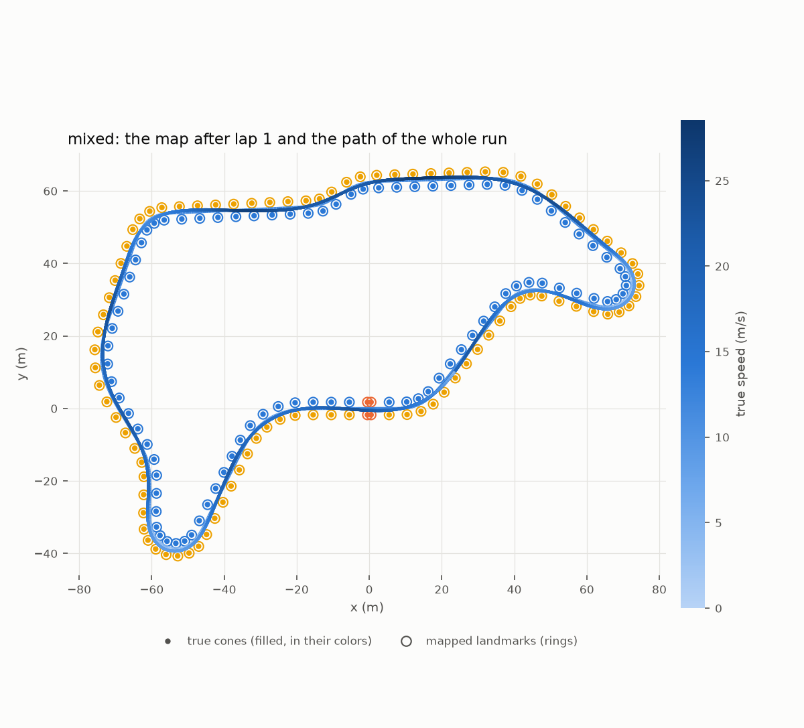
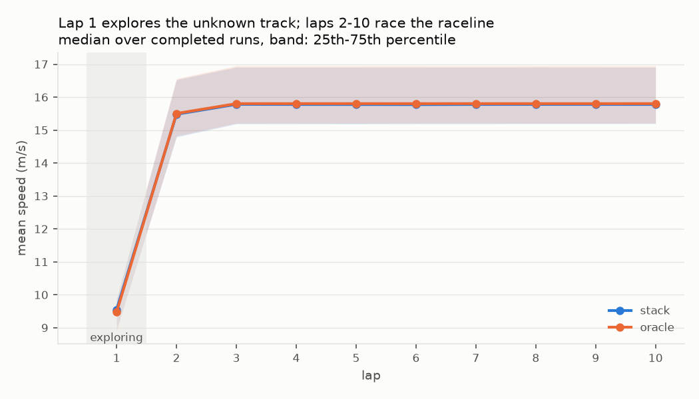
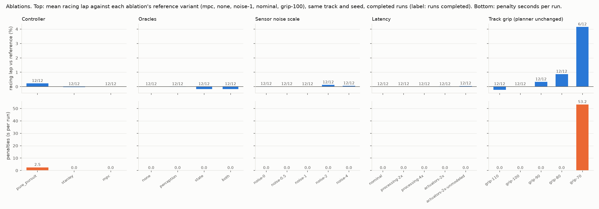
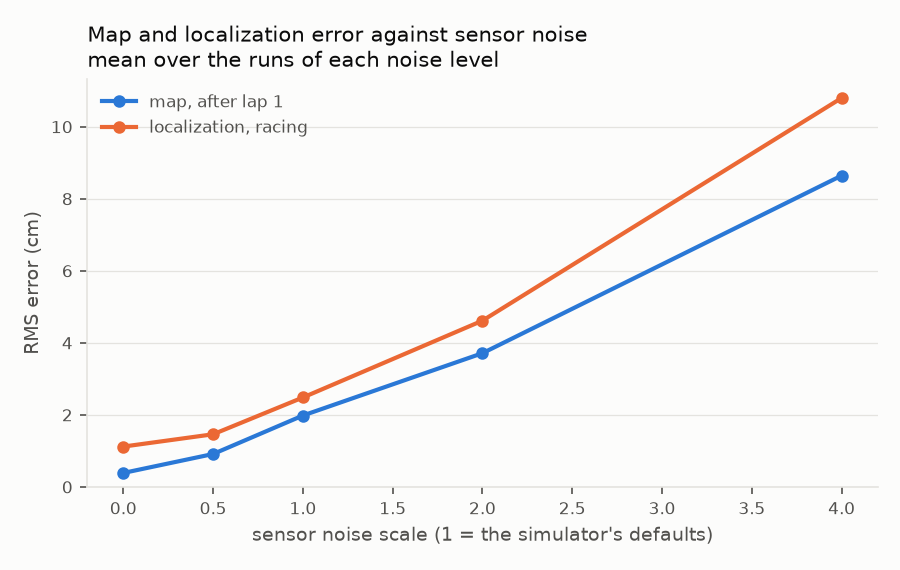

# Evaluation

How well does the car race a track it has never seen? This document answers with the
experiments of docs/design.md, section 8: the full stack on a fixed set of tracks and seeds,
compared run for run with the same car given perfect perception and state, and ablations of the
controller, the oracles, sensor noise, latency and grip. How a run is executed and scored, and
the exact definition of every metric, are in [runner.md](runner.md); how the car is assembled is
in [stack.md](stack.md). Every table here comes from `results/runs/`, every figure from
`tools/plot_evaluation.py` or `tools/plot_replay.py`; the numbers are those of commit f8037da.



**In short.** On eleven unseen tracks with three seeds each, the full stack finished all 33
ten-lap runs without knocking a cone or leaving the track, and so did the same car given perfect
perception and state. It maps every cone on lap 1 (median error 1.4 cm, no false or duplicate
landmark), matched none of 1.34 million observations to the wrong landmark, then races laps that
take 40% less time than the exploration lap, repeating them to within 0.02 s and to within 0.13
to 0.42% of the lap time its raceline predicts. Perfect perception and state would make it
0.04 s (0.18%) faster per racing lap. The three open issues of the previous evaluation are fixed:
the MPC steering the wrong way after its reference changed at speed, the map that stopped growing
above twice the default sensor noise (every run now finishes at four times), and duplicate
landmarks on the longest track. The only runs that fail are six of the twelve in which the
track has 70% of the grip the planner assumes.

## Reproducing

```
make PRESET=release build
tools/run_evaluation.sh                 # every sweep, the summary and the figures (8 min)
tools/run_evaluation.sh baseline        # one of them
```

Each sweep writes `results/runs/<sweep>/` (`runs.json` with every run's full result,
`summary.json` and `summary.md`); `tools/summarize_evaluation.py` gathers the summaries into
[results/runs/README.md](../results/runs/README.md) and `tools/plot_evaluation.py` draws
`docs/img/evaluation-*.png`. The 330 runs took 7 min 24 s on 8 threads of an Apple M4
(`THREADS=8 tools/run_evaluation.sh`). Runs are deterministic: the same build reproduces every
number except the wall-clock compute times, which are measured separately (see
[Compute](#compute)).

The figure above and the animation `docs/img/replay.gif` are one run (config
`results/runs/configs/replay.json`) recorded with `apex replay`; the recording (750 KB) is not
kept in the repository:

```
build/release/apps/apex replay --config results/runs/configs/replay.json --out replay.json
uv run --project tools python tools/plot_replay.py replay.json \
    --out docs/img/evaluation-replay.png --gif docs/img/replay.gif --speedup 3 --fps 12
```

## Method

**Tracks.** Eleven fixed circuits: the track generator's seeds 1 to 8 and its three reference
layouts.

| Track | Length (m) | Cones | Tightest radius (m) | Longest straight (m) | Hairpins | Chicanes | Sweepers | Other corners |
|---|---|---|---|---|---|---|---|---|
| gen1 | 431.5 | 203 | 7.3 | 60.5 | 3 | 5 | 1 | 1 |
| gen2 | 391.4 | 180 | 7.7 | 61.5 | 2 | 1 | 5 | 3 |
| gen3 | 231.1 | 109 | 7.2 | 59.5 | 1 | 2 | 2 | 1 |
| gen4 | 407.4 | 186 | 7.1 | 44.5 | 2 | 2 | 3 | 1 |
| gen5 | 394.6 | 183 | 7.2 | 33.5 | 3 | 2 | 3 | 2 |
| gen6 | 486.9 | 216 | 6.8 | 62.5 | 1 | 2 | 4 | 4 |
| gen7 | 405.2 | 195 | 7.1 | 31.0 | 4 | 1 | 1 | 5 |
| gen8 | 253.4 | 121 | 8.2 | 56.0 | 2 | 1 | 1 | 2 |
| technical | 315.0 | 152 | 6.4 | 26.5 | 3 | 2 | 1 | 1 |
| flowing | 473.5 | 201 | 7.0 | 61.0 | 1 | 1 | 8 | 2 |
| mixed | 414.5 | 186 | 6.8 | 39.0 | 2 | 1 | 3 | 4 |

(`apex track --seed N` or `--layout NAME` prints each line.)

**Runs.** A run is the mission of docs/design.md, section 1: staged 6 m behind the timing line,
ten laps (the first one exploring), then a stop, with every default of every module (the MPC
among the controllers), the default sensor noise and latencies (camera 40 ms, LiDAR 50 ms), the
nominal car equal to the true one and full grip. The run seed drives every random draw: each
sensor's noise, the camera's misses, confusions and false positives, and the oracles' noise.
The baseline uses run seeds 1 to 3 on all eleven tracks; the ablations, seeds 1 and 2 on six
of them (gen1, gen3, gen5 and the three layouts). A run ends as runner.md, "End of a run",
describes; a DNF still counts in every table, as not completed.

**The oracle.** Each baseline run is paired with the same track and seed driven with perfect
perception and perfect state (runner.md, "Oracles"). The *gap to the oracle* is the difference
of their mean racing laps: what estimation and perception cost in lap time, with the planner
and controller unchanged.

| Sweep | Variants | Runs | What it isolates |
|---|---|---|---|
| baseline | stack, oracle | 66 | completion, lap times, penalties, map, localization, association, tracking |
| controllers | pure pursuit, Stanley, MPC | 36 | the path-tracking controller |
| oracles | none, perception, state, both | 48 | the cost of each half of the car's state estimation |
| noise | sensor noise ×0, ×0.5, ×1, ×2, ×4 | 60 | robustness to worse (or perfect) sensors |
| latency | nominal; processing ×2, ×4; actuators ×2 known to the controller, ×2 unknown | 60 | processing and actuator delay |
| friction | track grip 110 %, 100 %, 90 %, 80 %, 70 % of the tires' nominal | 60 | a planner that assumes more (or less) grip than there is |

The configs are in [results/runs/configs/](../results/runs/configs/); `ctest` checks that each
one parses and expands to the runs above. The ablations compare each variant with a reference
variant (MPC, no oracle, noise ×1, nominal latency, full grip) run for run, on the same track
and seed. Compute is measured apart from the sweeps, one program at a time
([results/runs/compute.md](../results/runs/compute.md)).

## Results

### Completion, lap times and penalties

| | Completed | Lap 1 (s) | Racing lap, mean (s) | Cones / run | Off-course / run | Gap to oracle |
|---|---|---|---|---|---|---|
| full stack | 33/33 | 40.06 | 23.83 | 0 | 0 | 0.04 s |
| perfect perception and state | 33/33 | 40.26 | 23.79 | 0 | 0 | |



- **Lap 1 against the racing laps.** Exploring, the car drives what it has seen at up to
  12 m/s and must always be able to stop within it; racing, it follows the minimum-curvature
  raceline at the g-g-v envelope's speeds. The racing laps take 0.60 of lap 1 on average (0.55
  to 0.62 over the runs): 16.0 m/s mean speed against 9.5 m/s.
- **The racing laps are as planned.** Laps 3 to 10 of a run differ by 0.02 s on average
  (slowest minus fastest; 0.04 s at most) and are 0.13 to 0.42% slower than the raceline's
  predicted lap time (0.27% on average). Lap 2 is 0.62 s slower: it starts at the exploration
  speed. With the oracles, laps 3 to 10 differ by at most a millisecond and are 0.07 to 0.15%
  slower than predicted: the stack's spread comes from its perception and state estimates.
- **Perception and estimation cost almost nothing at racing pace**: 0.04 s per racing lap
  (0.18%; 0.01 to 0.08 s over the 33 pairs). The racing laps localize against the frozen map at
  1.7 cm (median RMS), which the MPC cannot tell from the truth.
- **Penalties**: none in the 66 runs.

| Track | Lap 1 (s) | Racing lap, mean (s) | Best lap (s) | Raceline's prediction (s) | Oracle's racing lap (s) | Completed |
|---|---|---|---|---|---|---|
| gen1 | 46.04 | 27.99 | 27.93 | 27.87 | 27.94 | 3/3 |
| gen2 | 40.96 | 24.84 | 24.79 | 24.74 | 24.81 | 3/3 |
| gen3 | 23.83 | 14.62 | 14.57 | 14.54 | 14.59 | 3/3 |
| gen4 | 42.58 | 26.41 | 26.32 | 26.26 | 26.37 | 3/3 |
| gen5 | 43.04 | 24.57 | 24.49 | 24.43 | 24.51 | 3/3 |
| gen6 | 47.51 | 27.98 | 27.88 | 27.83 | 27.93 | 3/3 |
| gen7 | 46.81 | 28.09 | 27.98 | 27.90 | 28.04 | 3/3 |
| gen8 | 28.33 | 16.74 | 16.69 | 16.65 | 16.71 | 3/3 |
| technical | 36.36 | 22.42 | 22.33 | 22.26 | 22.38 | 3/3 |
| flowing | 43.35 | 23.88 | 23.77 | 23.73 | 23.85 | 3/3 |
| mixed | 41.83 | 24.56 | 24.49 | 24.44 | 24.52 | 3/3 |

(Means over the full stack's runs of each track; the raceline's prediction is its speed
profile's lap time, `planning::profile_time`.)

### Mapping and localization

Over the 33 runs of the stack:

- **The map after lap 1** has exactly one landmark for each of the 109 to 216 cones of every
  track: no landmark without a cone behind it, no duplicate, every color right. Its position
  error is 1.4 cm RMS at the median run, 2.0 cm on average and 5.6 cm in the worst run
  (flowing, seed 2).
- **Localization** while exploring (mapping): 2.8 cm RMS at the median run, 4.0 cm on average
  and 16 cm in the worst run (the same flowing, seed 2); while racing on the frozen map: 1.7 cm
  median, 2.4 cm average, heading 0.02° RMS.
- **What the error comes from.** With perfect perception the map error is unchanged (2.0 cm in
  the oracle sweep with and without it): perception's detections are not the limit. With perfect
  state the map is 0.4 cm (mapping with known poses): the map error is the pose error of the
  SLAM filter while mapping, which grows with the sensors' noise (below).

### Data association

Of 1 368 709 cone observations, 1 341 336 were matched to a confirmed landmark, every one of
them to the landmark of its own cone: a **precision of 100%**. Of the 1 350 984 observations of
a cone that already had a landmark, 99.3% were matched to it (**recall**); the rest were gated
out or fed a tentative landmark. The truth ids only score the association: the stack's truth-id
test relabels them all and gets bit-identical commands (stack.md).

### Tracking

The MPC holds the raceline to **2.6 cm RMS** lateral error on average over the racing laps
(3.3 cm in the worst run) and follows the exploration paths, replanned at every scan, to
3.0 cm. The largest instantaneous error while racing, 0.53 m, is on gen7 in all three seeds,
and the same with the oracles, and is not a tracking error: it is the step at the switch to the
raceline, which on that track's start straight lies 0.53 m from the exploration path the car is
on. The MPC closes it in under a second (2 cm after 0.85 s), accelerating from 12 to 18 m/s.
While stopping, the car stays within 6 cm of its braking reference. The controller ablation
puts this in context:

| Controller | Completed | Racing lap vs MPC | Tracking RMS, racing | Cones / run |
|---|---|---|---|---|
| pure pursuit | 12/12 | +0.22% | 11.7 cm | 1.25 |
| Stanley | 12/12 | −0.04% | 10.6 cm | 0 |
| MPC | 12/12 | | 2.7 cm | 0 |

Pure pursuit cuts corners. In the two runs we traced (gen5 seed 1, mixed seed 2), five of its
six cones fell on the first racing lap and one in the stop, each with the car's center 0.78 to
1.07 m off the centerline. The raceline keeps half a meter between the car's body and the cone
line, and the MPC's car never strays more than 0.73 m from the centerline on those two tracks:
pure pursuit cuts more than the margin. (A knocked cone counts once, so later laps through the
same spot add nothing.) Stanley knocked no cone.

### Compute

| Work | p50 | p99 | Budget, p99 (docs/design.md, section 6) |
|---|---|---|---|
| Perception, one LiDAR scan | 202 µs | 269 µs | 10 ms |
| Estimation, one cone update | 117 µs | 567 µs | 5 ms |
| Estimation, one IMU prediction | 0.1 µs | 0.2 µs | 0.05 ms |
| Exploration plan | 54 µs | 90 µs | 10 ms |
| Raceline optimization (once) | 13 to 38 ms | | 2 s |
| MPC, one command | 252 µs | 341 µs | 2 ms |

The full stack on one core of an Apple M4 with nothing else running, three laps with the MPC on
each reference layout (`apex_runner_bench`; the highest p50 and p99 of the three runs).
[results/runs/compute.md](../results/runs/compute.md) has the machine, the build, the commands,
each module's own benchmark next to these numbers, and how they compare with the modules'
results. Every module is within its budget, the MPC by the smallest factor (6); a whole LiDAR
scan through perception, estimation and planning costs at most 0.8 ms against its 100 ms
period, and the closed loop, simulator included, runs 43.6 times faster than real time. The
sweeps' own timings, with eight runs at once, are 2.2 to 2.4 times higher at p99 and are not
used.

### Ablations



- **Oracles.** Perfect perception changes nothing measurable (−0.01% racing lap, the same map
  error). Perfect state makes racing laps 0.17% faster and the map exact (0.4 cm). None of the
  four variants knocked a cone in 48 runs.
- **Sensor noise.** From noiseless sensors to four times the default noise every run finishes
  with no penalty and racing laps within 0.12% of the default's, while the map error grows from
  0.4 to 8.6 cm and the racing localization error from 1.1 to 10.8 cm, roughly in proportion.
  At four times the noise the association recall falls to 81%: 8% of the observations (21 820
  of 260 053) fall between the association gate and the new-landmark gate and are left out, and
  6% more are inside a gate but left out of the joint hypothesis. Two of those 12 maps miss one
  cone each, and in 7 of the runs the estimator loses the map for a moment and widens its gates
  (1 to 8 times per run), with no effect on the track.
- **Latency.** Doubling or quadrupling the processing latency (LiDAR results 200 ms after the
  scan) or doubling the actuators' dead times changes neither completion nor the racing laps
  (±0.05%). An actuator delay the MPC does not know about doubles its tracking error (2.7 to
  5.2 cm) without a penalty. Lap 1 is 0.5 s slower with ×2 and ×4 processing latency, and 1.2 s
  faster with the doubled actuator delay known to the controller, which we have not explained.
- **Friction mismatch.** The planner keeps the tires' nominal grip and plans with 70% of it.
  With 10% more grip the racing laps are 0.22% faster; with 10% and 20% less, 0.33% and 0.87%
  slower, still with no penalty. At 70% of the nominal grip the envelope's margin is gone: the
  six runs on the reference layouts finish with 20 to 35 cones each, and the six on the
  generated tracks leave the track (three) or stall (three) during their first to third racing
  lap. Lap 1 takes as long as with full grip, since exploring plans with 70% of the nominal
  grip, but that is now all the grip there is, and the localization error while mapping reaches
  1.0 m RMS (0.16 m at most with full grip; 0.63 m already at 80%): flowing, seed 2 maps its
  cones at 1.27 m RMS and still finishes. Adapting the envelope to the measured grip is the
  obvious next step; the stack does not do it.



## Failure analysis

Every run that did not finish, and every penalty, by cause. The baseline has none.

**1. Friction mismatch at 70% grip (expected).** The six DNFs and the 254 cones of the grip-70
variant are the planner using grip the track does not have (above). To reproduce one:
`{"track": {"seed": 1}, "seed": 1, "friction_scale": 0.7}` with `apex run`.

**2. Pure pursuit (characteristic).** Its 15 cones, in 6 of its 12 runs, are the corner
cutting described under Tracking.

**3. The MPC's QP solver hits its iteration limit, rarely (observed, harmless).** About one
command in 100 000 (10 in the 66 baseline runs, at most 4 in one run) reaches the solver's 30
iterations, and the controller uses its fallback for that step. Outside grip-70, which has 40
of them, no run with one has a penalty. Example: `{"track": {"layout": "technical"}, "seed": 2}`.

**Fixed since the previous evaluation** (commit d51c587; the configs below reproduce them):

- **The MPC steered the wrong way just after its reference changed at speed** (control). On
  gen7 the car switching from the exploration path to the raceline (stack, seed 3) or starting
  its stop at 28 m/s (oracle, seed 2) steered away from the turn and left the track; two other
  runs knocked a cone each in the stop. The MPC's rollouts are now steered along the path, its
  traction limits leave room for the path's own lateral acceleration (v²κ), and it brakes to a
  stop when it faces away from the path. All six gen7 runs now finish without a penalty, and the
  switch at speed is the step of under a second described under Tracking. Configs: `{"track": {"seed": 7}, "seed": 3}` and
  `{"track": {"seed": 7}, "seed": 2, "oracles": {"perception": true, "state": true}}`.
- **Above twice the default sensor noise the map stopped growing** (estimation). At ×3 and ×4,
  every run failed at 3.5 s: staged, the estimator mapped six cones and rejected every other
  observation, because only observations within 20 m could start a landmark. The limit is now
  the 30 m of fused observations. Every ×4 run finishes, and the issue's config
  (`{"track": {"seed": 1}, "seed": 1, "sensor_noise_scale": 3.0}`, two laps) maps 203 landmarks
  for 203 cones at 3.2 cm and finishes with no penalty.
- **Duplicate landmarks on the longest track** (estimation, the same fix). gen6, seed 2 mapped
  224 landmarks for 216 cones at 58 cm RMS; it now maps 216 at 2.1 cm, and no baseline run has
  a duplicate. Config: `{"track": {"seed": 6}, "seed": 2}`.

## Limitations

- **The simulator's world is simple.** Flat ground, no LiDAR motion distortion, cones that stay
  in place when knocked, Gaussian sensor noise, a tire model with one friction coefficient
  per axle and no temperature or wear. The perception and estimation errors here are those of
  this world, not of a real track.
- **The car is the simulator's car.** The nominal model equals the truth unless an ablation
  says otherwise; real model mismatch is larger and less structured than the friction and
  latency ablations.
- **Eleven tracks and three seeds** measure typical behavior, not rare failures: the MPC's
  wrong-way steering fixed above showed in 4 of 66 baseline runs, all on one track, and a rarer
  failure would go unseen.
- **The grip is known.** The planner's envelope does not adapt to the track's grip, and 70% of
  the nominal is enough to make it fail (above).
- **Compute times** are those of one machine, an Apple M4, measured one program at a time
  (results/runs/compute.md); the sweeps' own timings, eight runs at once, are upper bounds.
