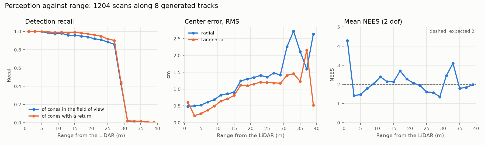

# Perception: LiDAR cone detection and camera color fusion

`apex::perception` turns one LiDAR scan and the buffered camera frames into the cones around the
car: `ConePerception::on_lidar(scan, yaw_rate)` returns `ConeObservations` with each cone's
center in the body frame at the scan's stamp, a calibrated covariance, and a color with its
confidence. The contract is `docs/design.md`, section 5.2; this document explains how the module
meets it, why each choice was made, what it measures, and where it fails.



## Pipeline

```
LidarScan ──▶ ground plane fit ──▶ obstacle points ──▶ grid clusters ──▶ cone checks ──▶ center fit
 (returns)    (robust, per scan)   (> 4 cm above it)   (0.15 m cells)    (size, count)    (visible face)
                                                                                              │
CameraFrame ──▶ time-sorted buffer ──▶ closest frame ──▶ gated joint matching ◀── covariance ◀┘
                                                             │
                                                             ▼
                                               ConeObservations (nearest first)
```

| Stage | Header | What it decides |
|---|---|---|
| Ground removal | `ground.hpp` | which returns are obstacles, and the sensor height the checks use |
| Clustering | `clustering.hpp` | which obstacle returns belong to one object |
| Cone checks, center, covariance | `cone_model.hpp` | whether a cluster is a cone; where its axis is; how sure we are |
| The LiDAR half assembled | `detector.hpp` | `ConeDetector`: the four stages above, with per-scan counts |
| Camera fusion | `camera_fusion.hpp`, `assignment.hpp` | each cone's color and color confidence |
| Covariance calibration (offline) | `calibration.hpp` | the covariance model's coefficients |
| The whole module | `perception.hpp` | `ConePerception`, `PerceptionConfig` (JSON), `PerceptionStats` |

Everything is deterministic: no randomness, no threads, no unordered iteration, and the only
state one scan leaves for the next is the ground estimator's fallback plane and the camera
buffer. A scan allocates nothing once the scratch buffers have grown. Nothing reads `truth_id`
except to pass it on: an observation's `truth_id` is its cluster's majority return tag (ties go
to the smaller id, so ground or clutter wins a tie with a cone), and a test scrambles every
truth id and checks that the output is otherwise bit-identical.

## Ground removal

The ground is flat, but the LiDAR's height above it is not known exactly: the car pitches and
heaves on its suspension, and a mount height error of 2 cm at a 4 cm threshold would either
leak ground into the clusters or cut the bottom off every cone. So the plane is fitted to each
scan:

1. **Seeds.** The lowest return in each 2 m × 2 m cell. A cone covers a small part of a cell, so
   almost every seed lies on the ground, and one seed per cell weights the far field (where a
   tilt error becomes a height error) as much as the dense near field. This is the
   lowest-point-representative idea of Zermas et al. (ICRA 2017), applied per cell.
2. **Robust plane fit.** `z = a x + b y + c` by iteratively reweighted least squares from a flat
   start at the median seed height: six iterations with Huber weights (convex, so it converges
   from that start), then six with Tukey's biweight, which gives outliers (seeds on cones in
   cells with no ground return, in shadows) zero weight. The scale is the median absolute
   residual, floored at 5 mm so a perfect ground does not reject everything but the best seeds.
3. **Threshold.** Returns more than 4 cm above the plane, along its normal, are obstacles. That
   is about ten times the height noise of ground returns at the LiDAR's grazing angles.

A fit is rejected if fewer than 20 seeds keep a nonzero weight, if it is not finite, or if the
plane tilts more than 10°; the previous accepted plane is used instead (the nominal mount height
before any success), the scan is counted in `PerceptionStats::ground_fallbacks`, and the change
of state is logged once. Cost: one pass over the points plus a few passes over ~1000 seeds.

The tests check that the fit finds a 0.12, 0.20 or 0.35 m sensor height within 5 mm with the
rig saying 0.20 m, follows a 2° pitch within 0.05° so that every ground return out to 50 m stays
under the threshold, and ignores a third of the cells holding obstacles. End to end, a car
whose LiDAR sits 0.30 m up while its rig says 0.20 m finds the same cones within 10 cm.

**Failure modes.**
- *Non-planar ground.* A crowned surface, a change of slope within the 40 m clustering range,
  or a curb: one plane cannot follow it, so ground leaks above the 4 cm threshold where the
  ground rises (false clusters, mostly rejected as too wide or floating) or the bottom of the
  cones is cut where it falls (fewer returns, lower recall at range). A per-sector or per-ring
  plane would fix it; FS tracks are flat enough that it was not worth the complexity.
- *Ground hidden.* With fewer than 20 cells holding ground returns (a wall alongside, a crowd
  of cones, a scan that is mostly dropouts) the fit falls back to the previous plane, which is
  wrong if the car has pitched since.
- *Steep tilts.* Beyond 10° the fit is rejected as implausible, so a real 10° slope or a
  mounting error that large is never followed.
- *Low obstacles.* Anything lower than 4 cm (tape, a flattened cone) is ground.

## Clustering

Obstacle returns are binned into a 0.15 m grid over the LiDAR's azimuth sector out to 40 m, and
the connected components of the occupied cells under 8-connectivity are the clusters (a flood
fill with an explicit stack; each cell keeps a linked list of its points). Every step touches
each point or each occupied cell a constant number of times, and only the cells touched by this
scan are reset, so the cost is linear in the number of points and independent of the grid's
size.

The cell size fixes the guarantees, which the tests check on random point pairs: returns closer
than 0.15 m always share a cluster, and returns farther apart than 2√2 × 0.15 = 0.42 m are never
joined directly. 0.15 m keeps the returns of one cone together out to 40 m (azimuth steps of
0.2° are 0.14 m apart there), and the closest cones on a track, the timing line's big cones 1 m
apart center to center (0.72 m surface to surface), are never merged. DBSCAN would give much
the same clusters with a radius search per point; the grid is simpler, has no parameters beyond
the cell size, and its output order is fixed by the input order.

Returns beyond 40 m are not clustered: a small cone there gives at most one return, too few to
tell from noise.

## Cone validation

A cluster is accepted only if it could be a cone at its range. `ConeValidator` checks, in order:

| Check | Rejects | Bound |
|---|---|---|
| Too tall | posts, people, cars | highest return > big cone height (0.505 m) + 8 cm |
| Too wide | walls, merged cones | extent across the line of sight > big cone diameter + one azimuth step + 12 cm |
| Too deep | objects seen along their length | extent along the line of sight > big cone radius + 12 cm |
| Floating | overhanging objects, a cone's top seen alone | lowest return > threshold + one channel spacing at that range + 10 cm |
| Too few points | far-away noise, slivers | fewer than 3 returns, or fewer than 30% of what an unoccluded small cone gives at that range |
| Too many points | merges, large objects | more than 2 × what an unoccluded big cone gives, plus 3 |

The expected count comes from the beam geometry (`expected_cone_returns`): each channel at
elevation e crosses the cone's near face at height z = h + d tan e (h the fitted sensor height,
d the horizontal distance to the face); where the threshold < z < H, the cone's section there has
radius ρ = R (1 − z / H) and subtends 2 asin(ρ / r) at range r, so the channel gives that angle
divided by the azimuth step, on average over the azimuth phase. Summed over the channels, this
matches the tests' ray caster's mean count within 15% plus one return from 2 to 30 m, for both sizes
(test `ExpectedConeReturns`). Because
the bounds scale with range, a cluster of 3 returns is a plausible cone at 25 m and noise at 8 m.

**Why `min_points` is 3.** At the default rig (0.25° between channels, 0.2 m mount) a small cone
gives about 19 returns at 10 m, 4.4 at 20 m, 3.7 at 25 m and 1.2 at 30 m. Two returns are as
likely to be a chance pair of clutter points as a cone: in the test with 300 random returns
over 35 m × 40 m, pairs passed every other check and came out as two false cones. Three
returns remove them, and the cost is that small cones beyond about 28 m are not reported; the
recall curve above falls off a cliff there. The estimator sees each cone many times as the car
approaches, so recall beyond 28 m buys only earlier first sightings.

In the evaluation (below) no cluster was too tall, wide, deep or dense, since the simulated
tracks have nothing but cones; 9633 were rejected for too few points (distant cones) and 100 as
floating, most likely cone tops whose lower part is hidden behind a nearer cone. The other
checks are exercised by the unit tests (`ConeValidator.RejectsWhatCannotBeACone`).

## Center estimation

The LiDAR sees only the near face of a cone, so the centroid of its returns sits up to π/4 of
the radius in front of the axis: 9 cm for a small cone, a bias the estimator would integrate
into the map. Instead, each return at height z above the ground is taken to lie on the cone's
surface, at horizontal distance ρ(z) = R (1 − z / H) from the axis, and the center c minimizes

    Σ_i (|p_i − c| − ρ(z_i))² / σ_r² + |c − c0|² / R²

by Gauss-Newton (six iterations, σ_r = 2 cm). The prior c0 is the centroid pushed π/4 of the
mean ρ away from the LiDAR, which is where the center lies behind returns spread evenly across
the visible half of a circle; it only settles the directions the returns leave unconstrained (a
single column of returns at long range). If the fit ever puts the center in front of the
centroid, it has diverged and the prior is used. Fitting the face, rather than offsetting the
centroid along the line of sight, keeps a partly occluded cone right: the visible arc still
fixes the circle (test `FitConeCenter.RecoversAHalfVisibleCone`: within 3 cm, where the
centroid is off by more than 3 cm sideways, which no offset along the line of sight corrects).

**Small or big cone.** R and H differ between small cones (0.114 m, 0.325 m) and the big
orange ones (0.1425 m, 0.505 m), a 3–4 cm difference in ρ at the heights the LiDAR sees. A
return higher than 0.38 m settles it, but a big cone's top is often unseen: above the highest
channel close by, between channels far away. Otherwise both sizes are fitted and the big cone
wins only if its log-likelihood ratio (S_small − S_big) / (2 σ_r²), from the residual sums S,
beats the prior odds ln(4 / 146) = −3.6 of a trackdrive's 4 big cones among ~150. The sizes are
told apart by how they taper: 2.8 mm of radius per cm of height for a big cone, 3.5 mm for a
small one. In the evaluation, 565 of 676 big cones (84%) were fitted as big and 19 of 19 325
small cones (0.1%) as big; the misses are far big cones with few returns, where the 3–4 cm
error of the small-cone fit is within the covariance.

Center error, RMS over the true positives (evaluation below):

| Range (m) | 0–10 | 10–20 | 20–30 | 30+ |
|---|---|---|---|---|
| Position (cm) | 0.7 | 1.4 | 1.8 | 2.7 |
| Radial (cm) | 0.6 | 1.1 | 1.4 | 2.3 |
| Tangential (cm) | 0.4 | 0.9 | 1.2 | 1.5 |

## Covariance

The covariance is diagonal along (radial) and across (tangential) the line of sight from the
LiDAR, each variance a function of the horizontal range r and the cluster's return count n:

    v(r, n) = c₀ + c₁ r² + c₂ / n + c₃ r² / n

The terms are a floor for model error, the growth of the angular resolution's footprint with
range, range noise averaged over n returns, and angular quantization averaged over n returns.
It grows with range and shrinks with the count, as the contract asks, and a partly occluded cone
(fewer returns than an unoccluded one at the same range) gets a larger covariance.

**Calibration.** `fit_variance_model` fits the coefficients to the center errors of the
evaluation's true positives by maximum likelihood, treating each error coordinate as
e ~ N(0, v(r, n)): iteratively reweighted least squares on e² with weights 1 / v² (a Gamma GLM
with identity link; McCullagh and Nelder, 1989), over every subset of the three non-constant
terms, keeping the best fit with no negative coefficient. At the optimum the mean of e² / v is
exactly 1 per coordinate, so the NEES averages 2. The test `FitVarianceModel` recovers a known
model from 20 000 Gaussian samples within 15%.

| Default (m²) | c₀ | c₁ (per m²) | c₂ | c₃ (per m²) |
|---|---|---|---|---|
| Radial | 2.1e-5 | 1.4e-7 | 3.7e-4 | 0 |
| Tangential | 1.1e-5 | 1.1e-7 | 0 | 6.2e-7 |

So a cone at 10 m with 19 returns has σ = 7 mm radially and 5 mm tangentially; at 25 m with 4
returns, 14 mm and 13 mm. The hand-set model this replaced was about nine times too large
(NEES 0.22).

| Range (m) | 0–10 | 10–20 | 20–30 | 30+ | all |
|---|---|---|---|---|---|
| Mean NEES (2 expected) | 1.88 | 2.34 | 1.75 | 2.38 | 1.99 |
| NEES above 5.99 (5% expected) | 2.2% | 8.3% | 4.6% | 8.0% | 5.2% |

The model is calibrated on the simulator's LiDAR (`apex_perception_eval` prints and saves the
fitted coefficients on every run, so a change of the sensor model shows up as a mismatch
there). A real sensor must be recalibrated: its errors also include beam divergence, mixed
returns at cone edges, extrinsic calibration and motion distortion, which the simulated scans
and so this model have no term for.

## Camera fusion

**Buffer.** `on_camera` keeps the 8 newest frames sorted by stamp, whatever order they arrive
in: a frame with an already-buffered stamp replaces it, and once the buffer is full a frame
older than all of them is dropped (`PerceptionStats` counts both). `on_lidar` takes the frame
closest in time to the scan; if none is within 60 ms, every cone stays `Unknown` rather than
taking stale colors.

**Prediction.** Each cone, in the body frame at the scan's stamp, is rotated by
−yaw_rate (t_camera − t_scan) about the body origin: where the car's turning between the stamps
moves it relative to the car. Its bearing and ground-plane range are then taken from the camera
mount, as the detector reports them. The car's translation between the stamps is not known to
perception (the interface passes only the yaw rate), so it is absorbed in the bearing tolerance.

**Matching.** Each pair of a cone inside the camera's field of view (plus 0.05 rad) and range
(plus 2 m) and a detection gets the cost

    d² = (Δbearing / σ_b)² + (Δrange / σ_r)²,
    σ_b² = (0.01 rad)² + (0.6 rad/s × |t_camera − t_scan|)²,   σ_r = 0.3 m + 0.08 r,

with the range tolerance growing with distance as monocular depth error does. Pairs with
d² ≥ 9.21 (the 99% χ² gate for 2 dof) are never matched; the rest are assigned jointly by
minimum total cost, each cone also allowed to stay unmatched at the gate's cost
(`solve_assignment`: the Hungarian method in its shortest-augmenting-path form, Kuhn 1955,
Jonker and Volgenant 1987, checked against brute-force enumeration). Joint assignment is what
handles a near and a far cone at almost the same bearing: each takes the detection whose range
fits, rather than the first cone claiming the closer detection, and if the camera saw only the
far one, the near cone stays `Unknown` (test
`CameraFusion.SeparatesNearAndFarConesAtTheSameBearing`).

**Confidence.** The detector's confidence times the match quality exp(−d² / 2): 1 for a perfect
match, 0.01 at the gate. A matched detection whose color is `Unknown` leaves the cone `Unknown`
with confidence 0.

| Camera frame (evaluation below) | Coverage | Accuracy | Confidence, right / wrong |
|---|---|---|---|
| 25 ms early, yaw compensated | 66.8% | 94.4% | 0.62 / 0.57 |
| At the scan's stamp | 70.0% | 95.1% | 0.78 / 0.67 |
| 25 ms early, not compensated | 66.2% | 94.5% | 0.58 / 0.49 |
| 50 ms early, yaw compensated | 65.4% | 94.5% | 0.55 / 0.49 |
| 50 ms early, not compensated | 65.6% | 94.0% | 0.50 / 0.45 |
| 25 ms early, compensated; detector without color errors or false positives | 66.2% | 99.75% | 0.62 / 0.03 |

Coverage is the share of detected cones inside the camera's view that got a color. It is bounded
by the detector, which finds half the cones at 22 m and hides those behind others. Accuracy is
bounded by the detector's own color confusion (1% near, 10% at 30 m): with a detector that
never confuses colors, the fusion's own association errors are 0.25%, and their confidence
(0.03) is a twentieth of that of right matches, so the estimator's color votes can weigh them
down. The yaw compensation raises the match quality, and so the confidence, by 7–10% at both
lags; coverage and accuracy move by less than half a point either way, within this run's noise.
At the yaw rates of an exploration lap (up to about 1.3 rad/s in hairpins) the uncompensated
rotation, at most 0.03 rad at 25 ms, stays mostly inside the bearing tolerance that the car's
untracked translation already requires; the compensation matters more for a faster car or a
longer gap. The range tolerance (2.7 m at 30 m) is about twice the simulated detector's range
noise (0.05 m + 0.0015 r², 1.4 m at 30 m): conservative, which costs little because cones at
similar bearings rarely sit within a few meters of each other's range.

## Evaluation

```sh
make PRESET=release build
build/release/bench/perception/apex_perception_eval           # writes results/perception/
uv run --project tools python tools/perception/plot_eval.py    # writes docs/img/perception-range.png
```

The bench (`bench/perception/`) generates 8 tracks (`sim::generate_track`, seeds 1–8, 231 to
487 m, 1 393 cones) and scans every 2.5 m along each centerline: 1 204 scans. The car is
offset from the centerline by up to ±0.3 m and ±0.03 rad (1σ) in heading, driving at up to
12 m/s and at most 10 m/s² of lateral acceleration, which sets the yaw rate. Scans come from
`sim::simulate_lidar` with its default noise: the default rig's 64 channels, exact rays against
the 3D cone bodies and the flat ground (cones occlude each other), 2 cm range noise and 2%
dropout. Camera frames come from `sim::simulate_camera`: 0.003 rad bearing noise, range noise
0.05 m + 0.0015 r², detection probability 0.98 / (1 + exp((r − 22 m) / 3 m)) from 2 m out,
cones hidden behind others not detected, color confusion rising from 1% to 10% over its 30 m
range, and 0.3 false positives per frame (docs/sim.md). A detection is a true positive when its
truth id names a cone within 0.5 m that no other observation claimed; anything else is a false
positive. Results: `results/perception/eval.json` and `summary.md`.

| Range (m) | Cones in view | Recall | Recall of cones with a return | Precision | Position RMS (cm) | NEES |
|---|---|---|---|---|---|---|
| 0–10 | 5 574 | 99.1% | 99.7% | 100% | 0.7 | 1.88 |
| 10–20 | 7 215 | 95.6% | 98.4% | 100% | 1.4 | 2.34 |
| 20–30 | 9 355 | 79.6% | 83.2% | 100% | 1.8 | 1.75 |
| 30+ | 20 026 | 0.6% | 0.7% | 100% | 2.7 | 2.38 |

False positives: 0 in 1 204 scans. "Cones in view" counts every cone inside the LiDAR's ±90°
and 50 m, occluded or not, so 30+ includes 40–50 m, beyond the clustering range.

**Latency.** `on_lidar` (whole pipeline, including the fusion) in Release on the Apple M4, which
was shared with five other workers (load average 12 during the run): p50 215 µs, p99 484 µs,
max 1.2 ms over the 1 204 scans, against a 10 ms budget at p99. Under heavy contention from the
other workers' builds (load averages of 30 to over 100 on 10 cores) the same run gave p99 2.6 to
2.9 ms, still well inside the budget, but a worst single scan of up to 10.6 ms: the tail then
depends on the scheduler, not on the pipeline, whose work per scan is the same.

The module was developed against the tests' own ray caster (`tests/perception/scene.hpp`) before
the simulator's sensor models existed. The two agree: a test checks the caster point for point
against the simulator's brute-force reference LiDAR, and with the same seeds the bench's LiDAR
numbers did not change by a digit when it switched to `simulate_lidar`. The tests keep the
caster because it can also pitch the sensor and misplace its mount, which the ground-removal
tests need.

The tests (`ctest --preset dev -L perception`, 60 tests, about 2 s) cover each stage on
synthetic data with known answers, occluded and half-visible cones, adjacent cones not merged,
empty scans and bare ground, non-finite returns, camera frames out of order, missing or stale,
the near/far bearing case, the whole pipeline on the simulator's sensor models, determinism
across instances, and independence from truth ids.

## Failure cases and limitations

- **Small cones beyond ~28 m are not reported** (`min_points` = 3, see above); big cones last to
  about 35 m.
- **A cone hidden behind a nearer one** is missed while hidden; if only its top shows above the
  occluder, the cluster is rejected as floating (100 clusters in 1 204 scans).
- **Two cones closer than 0.42 m** (surface to surface) can merge into one cluster. The width,
  depth and count checks are there to reject such a cluster, so both cones are lost for that
  scan rather than reported at a wrong position; a merge small enough to pass would be reported
  as one cone between the two. FS cone spacing makes this rare except for knocked-over cones,
  and the evaluation's tracks never produced one.
- **Very close cones** (under 2 m from the LiDAR, 2% of the true positives) have a mean NEES of
  4.3: their tangential error is twice the model's. They stand nearly abeam of the car, which is
  about to pass them; the cause has not been isolated, and a range-dependent floor would trade
  calibration elsewhere.
- **Big cones fitted as small** (16% of big cones, mostly far) are placed 3–4 cm short.
- **Color under translation.** Only the rotation between the camera and LiDAR stamps is
  compensated; the car's forward motion (0.3 m in 25 ms at 12 m/s) shifts near cones abeam by
  more than the bearing tolerance, so they go uncolored for that scan.
- **Ground removal** assumes one plane per scan (failure modes above).
- **Camera-only cones** beyond LiDAR range (optional in the contract) are not reported.

## Configuration

`PerceptionConfig` holds one struct per stage (`ground`, `clustering`, `cone_check`,
`center_fit`, `covariance`, `camera`); its JSON keys are the field names, missing keys keep the
defaults above, and unknown keys throw. Invalid values throw `std::invalid_argument` when a
`ConePerception` is constructed; `on_lidar` never throws and counts every stage's outcome in
`PerceptionStats` (returns, non-finite returns, obstacle points, ground fallbacks, clusters by
check outcome, camera frames added, replaced and dropped, scans without a usable frame).

## References

- P. J. Huber, "Robust estimation of a location parameter", Annals of Mathematical Statistics
  35(1), 1964.
- A. E. Beaton and J. W. Tukey, "The fitting of power series, meaning polynomials, illustrated on
  band-spectroscopic data", Technometrics 16(2), 1974.
- P. W. Holland and R. E. Welsch, "Robust regression using iteratively reweighted
  least-squares", Communications in Statistics 6(9), 1977.
- D. Zermas, I. Izzat and N. Papanikolopoulos, "Fast segmentation of 3D point clouds: a paradigm
  on LiDAR data for autonomous vehicle applications", ICRA 2017.
- H. W. Kuhn, "The Hungarian method for the assignment problem", Naval Research Logistics
  Quarterly 2, 1955.
- R. Jonker and A. Volgenant, "A shortest augmenting path algorithm for dense and sparse linear
  assignment problems", Computing 38, 1987.
- P. McCullagh and J. A. Nelder, "Generalized Linear Models", 2nd ed., Chapman & Hall, 1989.
- Y. Bar-Shalom, X. R. Li and T. Kirubarajan, "Estimation with Applications to Tracking and
  Navigation", Wiley, 2001 (NEES consistency test).
