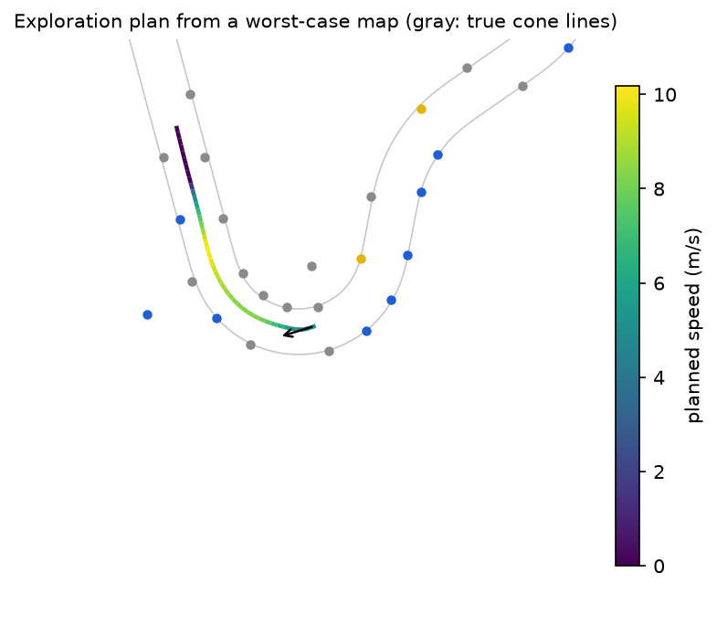
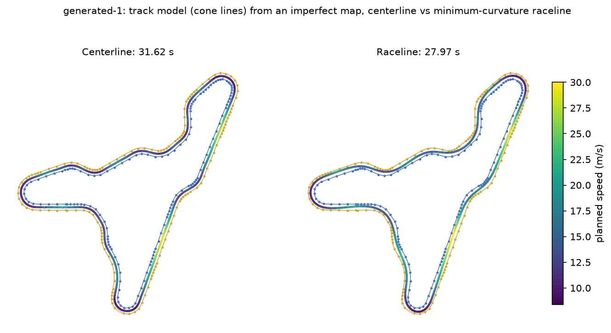

# Planning (`apex::planning`)

Where the car should drive and how fast. On lap 1 the exploration planner finds a path through
the cones mapped so far, at a speed from which the car can always stop within what it has seen.
When the lap closes, the track model orders the final map into two cone lines and a centerline,
and the raceline optimizer bends that centerline into the least curved line the track allows.
Every path gets its speed from one g-g-v envelope of the nominal car. This document explains each
part, the choices behind it and how well it works; the contract with the other modules is
docs/design.md, section 5.4. Measured results are in
[`results/planning/`](../results/planning/README.md).

| Part | Header | Source |
|---|---|---|
| Speed profiles, configs, public API | `planning/planning.hpp` | `speed_profile.cpp`, `config_json.cpp` |
| g-g-v envelope | `planning/ggv.hpp` | `ggv.cpp` |
| Exact predicates, Delaunay triangulation | `planning/predicates.hpp`, `planning/delaunay.hpp` | `predicates.cpp`, `delaunay.cpp` |
| Exploration planner | `planning/midpoint_search.hpp` | `exploration.cpp`, `midpoint_search.cpp` |
| Polyline resampling and smoothing | `planning/smoothing.hpp` | `smoothing.cpp` |
| Track model | `planning/planning.hpp` | `track_model.cpp` |
| Raceline | `planning/raceline.hpp` | `raceline.cpp` |
| QP solver | `planning/qp.hpp` | `qp_solver.cpp` |

```cpp
apex::planning::ExplorationPlanner explorer({}, nominal);
std::optional<apex::Trajectory> path = explorer.plan(cone_map, state);   // lap 1, every scan
std::optional<apex::planning::TrackModel> track =
    apex::planning::build_track_model(final_map, driven_poses, {});      // lap 1 closed
apex::planning::Raceline raceline = apex::planning::optimize_raceline(*track, nominal, {});
```

## Speed profiles

`apply_speed_profile` fills a path's speed and acceleration from a g-g-v envelope of the nominal
car (`GgvEnvelope`), axle by axle, with the forces split as the car splits them:

- **Normal loads.** Each axle carries its static weight share w (lr / L front, lf / L rear),
  its share of the downforce q v^2 (q = rho ClA / 2 = 2.1 N s^2/m^2, 45% on the front), and the
  longitudinal load transfer h Fx / L (driving loads the rear, braking the front), as in the
  simulator's vehicle model.
- **Forces.** The longitudinal force Fx is split by `drive_split_front` (0.4) or
  `brake_split_front` (0.6); the lateral force m v^2 kappa by the steady-state yaw balance, lr / L
  to the front and lf / L to the rear. Each axle must stay inside its own friction ellipse
  scaled by the grip factor f: (s Fx)^2 + Y^2 <= (f mu N)^2. With N linear in Fx this is a
  quadratic in Fx, and the largest force each axle allows has a closed form.
- **Powertrain.** Drive force is limited by `max_drive_force` (3 kN) and `max_power / v`
  (80 kW), braking by `max_brake_force`; drag and rolling resistance (on the normal load with
  downforce) cost acceleration and help braking.

The first version had one friction ellipse for the whole car, using all four tires' grip for
braking. In closed loop the racing profile then asked the rear axle for more than it had: braking
moves load to the front while the rear still takes 40% of the brake force, and in a corner it also
carries lf / L of the lateral force. At 25 m/s on a straight the rear limits the tires' braking
to 17.2 m/s^2 (grip factor 0.85) where the whole-car ellipse allowed 20.8, and corner entries
slid. At low speed the front limits driving to 2.4 kN of the motors' 3 kN for the same reason.
Lateral load transfer is still ignored; the grip factor absorbs it.

The profile is the classic forward-backward integration (Velenis and Tsiotras, JOTA 2008): every
point is capped by its steady cornering speed (the largest v whose lateral demand v^2 kappa
leaves the tires enough longitudinal grip to balance drag; with downforce and no drag it has the
closed form of `GgvEnvelope::cornering_speed`), the forward pass limits how fast the car can have
accelerated into it, and the backward pass how fast it can be and still brake for what follows.
Each step integrates u = v^2 with Heun's method; next to the friction ellipse's edge, where the
available acceleration falls steeply with speed, an overshooting step is cut back by bisection to
the largest speed whose step rate one of its ends can sustain. A closed path starts both passes at
its slowest point, so one lap of each is exact and periodic; an open path starts at a given speed
and ends at another (0 for the exploration path).

Tests compare against closed forms: a circle's speed with downforce solved exactly (to 1e-9),
sqrt(f mu g r) without downforce, a circle with drag where the more loaded axle sits exactly on
its ellipse, rear-axle-limited and brake-force-limited stopping distances, front-axle-limited,
drive-force-limited and power-limited acceleration (to 0.2% at 0.5 m spacing, the
integrator's error), braking in a corner that saturates exactly the rear axle, and a generated
track's profile staying inside the envelope across the periodic seam. One test checks the
envelope against the simulator itself: with the grip factor at 1, its largest braking force on
a straight is where the simulated rear axle reaches traction (to 1e-6), under the normal loads
the simulator computes.

## Exploration

`ExplorationPlanner::plan(map, state)` runs every LiDAR scan:

1. **Cones.** The mapped cones within 25 m of the car and at most 4 m behind it, the 80 closest.
   Each keeps its color as a side vote: +1 for blue, -1 for yellow, times the share of the
   map's color votes behind that color; orange and unknown cones vote for neither side.
2. **Triangulation.** Delaunay, the module's own: Bowyer-Watson insertion with the hull closed
   by ghost triangles to a vertex at infinity, a visibility walk to locate each point, and
   Shewchuk's adaptive exact predicates (an error-bounded floating-point determinant, falling
   back to expansion arithmetic when the sign is uncertain), so collinear, duplicate and
   cocircular inputs need no epsilon. `predicates.cpp` is compiled with `-ffp-contract=off`, as
   the expansion arithmetic needs every product rounded on its own. The tests check the
   empty-circumcircle property and Euler's formula against brute force on random sets, noisy
   cone strips, grids, collinear sets, duplicates, and 48 integer points on one circle (every
   quadruple cocircular), also shifted far from the origin.
3. **Search** (`search_midpoint_path`). A path is a walk through adjacent triangles: it crosses
   an edge ahead of the car (midpoint within 6 m, or further, below), enters the triangle beyond, and leaves each
   triangle through one of its two other edges. On a track the crossed edges are the rungs and
   diagonals between the cone lines; the triangle's third edge is a segment of a cone line, and
   which cone is on the left of each crossed edge follows from the triangle's orientation. A beam
   search (width 12, up to 24 edges or 30 m) keeps the cheapest candidates at each depth, and
   drops a candidate entering a triangle through the same edge as a cheaper one. Each crossed
   edge scores:

   | Term | Cost per edge (defaults) | Why |
   |---|---|---|
   | Width | 6 ((w - 3.5) / 3.5)^2, w the track's width there (below) | FS tracks keep their width; an edge out to clutter or across two parts of the track is too wide |
   | Curvature | 3 (kappa / 0.15)^2, kappa the turn between midpoints over their spacing | the track turns smoothly; a path that cuts out of it turns sharply |
   | Heading | (turn from the car's heading / 30 deg)^2, first edge only | the car cannot turn on the spot |
   | Color | 4 per cone on the wrong side, times its share of the color votes | blue left, yellow right; a confident wrong side outweighs a step's length reward, a narrowly voted one does not |
   | Spacing | ((l - 5) / 5)^2 for a cone-line segment longer than 5 m | FS cones stand at most 5 m apart; longer means missing cones or a wrong turn |
   | Length | -1 per meter | a longer path wins unless its extra edges look wrong |

   Hard limits prune outright: a width outside 2-5.5 m, an edge longer than 12 m, a cone-line
   segment longer than 15 m (two missing cones on a straight), a turn above 50 degrees, and a
   midpoint, or the segment between two consecutive ones, closer than 1 m to any mapped cone.

   **Start.** The first edges are those with their midpoint ahead of the car within 6 m. When
   none of them passes the hard limits, the search starts instead from the nearest edge ahead
   that does, and every edge within 2 m beyond it (the two or three edges of the first pair of
   cones), out to the 25 m the cones are taken from; the path then runs straight from the car to
   its first edge, and smoothing turns it. This is the staging case at three or four times the
   nominal sensor noise: perception loses the big orange cones beside the car, the nearest edge
   is 11-14 m ahead, and with only the 6 m radius every run failed at 3 s with no path. Widening only when nothing close is usable keeps the nominal behavior, and taking the
   nearest edge that passes the limits, not the nearest one, matters: in a recorded map the
   nearest edge, at 12.5 m, ran out to another part of the track.

   **Clearance.** Without colors, a path straight across the infield of a hairpin, between the
   cones of its inner line, can look like a straight corridor: in a run at four times the noise
   it scored -7.3 against -7.2 for the path around the hairpin (the hairpin's curvature costs
   more than its extra length earns), and the car followed it into a cone. The cones it cut
   past are not those of the edges it crossed, so no width or spacing limit saw them. The 1 m
   clearance from every mapped cone rules it out. On the evaluation below it also raises the
   share of paths inside the track (98.7% to 99.0% of those found on nominal maps, 95.8% to
   96.2% on worst-case ones) and loses one plan in 1,442 per level. The first edge checks only
   its midpoint: the car may stand close to cones, and a straight run out to a far first edge
   is not the path the car drives in a curve (checking it rejected the right first edge in a
   curve and sent one plan 18 m off the track).

   **Width.** Each triangle the path traverses has one edge it does not cross, a segment of one
   cone line, and one vertex shared by its entry and exit edges, a cone of the other line; the
   distance from that cone to that segment is the track's width, whatever the direction of
   travel. The first version measured the crossed edge's extent across the direction of travel
   instead, which made an edge out to a stray landmark look narrower than it is (measured
   across the direction to its own midpoint) or a long diagonal across a gap in a curve look far
   wider (measured across the incoming direction). The cone-line width overestimates mainly in
   the fan of triangles on the outside of a tight hairpin, where the inner cone faces several
   outer ones; taking the smaller of the two measures was worse overall. The first edge, before any cone line, uses its extent across the
   car's heading.

   The scheme follows the boundary estimation of Kabzan et al., "AMZ Driverless: The full
   autonomous racing system", Journal of Field Robotics 37(7), 2020. The weights were tuned on
   the evaluation below (`--config` runs it on any ExplorationConfig): the curvature weight and
   the turn limit matter most, the color and width weights little.
4. **Path.** The car's position and the midpoints are resampled every 1 m and smoothed with a
   Whittaker smoother (Whittaker 1923, as penalized least squares in Eilers, Analytical
   Chemistry 75(14), 2003; `smoothing.hpp`) with an 8 m cutoff wavelength, whose first two
   points are pinned to the car's position and heading, then sampled every 0.5 m. The
   free-space widths are the distances to the two cone lines the search found, extended back
   past the car and a spacing beyond their last cone.
5. **Speed.** The exploration speed config (grip factor 0.7, 12 m/s cap) from the car's current
   speed down to 0 m/s a fifth of the path's length (at least 1 m) before its end: the car can
   always stop within the cones it has seen, with room to spare when the next plan's path ends
   closer. That happens where the map is sparse: entering a hairpin whose apex is not mapped
   yet, the path ends at the last cones that look like track, and as the car approaches, the
   frontier can move back (15 m paths shrank to 6 m in one run, and with the MPC of the time the
   car hit a cone there). With the current MPC, in closed loop at four times the noise (8
   tracks, 6 seeds), lap 1 hit no cone with a reserve of 0 or 0.2 and one run hit cones with
   0.4, which also slows lap 1 by a second (the car crawls on short paths); 0.2 keeps the
   guard for 0.2 s of lap 1. Without a path, `plan` returns nothing and counts a failure; the
   stack then brakes on its last path.

### Evaluation

The imperfect maps (`tests/planning/support/cone_maps.hpp`) are made from a track's true cones:

| Error | Nominal | Worst case |
|---|---|---|
| Position error (2D RMS, isotropic Gaussian) | 10 cm | 15 cm |
| Cones never mapped | 10% | 20% |
| Wrong color (winning 2/3 of the landmark's votes) | 5% | 10% |
| No color (Unknown) | 33% | 50% |
| Clutter landmarks, 1-5 m beyond a cone line (30% colored) | 2 per 100 m | 4 per 100 m |

A third of the colors are Unknown because the perception module colors about two thirds of its
detections (its camera match fails at range). The car drives each track's centerline from its
staging pose, mapping the landmarks that come within a sensor range in its front half-plane,
and plans every 5 m from a pose up to 0.4 m and 0.1 rad off the centerline at 8 m/s. The
range is 20 m, the estimator's new-landmark range when the evaluation was written: the numbers
stay comparable, and the shorter range is the sparser case. The estimator now starts landmarks
out to 30 m (since 949d860); the third column repeats the nominal maps at that range. A path
is *inside* when every point of it is between the true cone lines. On 20 generated tracks,
1,442 plans per level (`apex_planning_exploration_eval`, Release, Apple M4):

| | Nominal | Worst case | Nominal, 30 m |
|---|---|---|---|
| Path found | 99.3% | 97.4% | 99.4% |
| Inside the true cone lines, of the paths found | 99.0% | 96.2% | 99.0% |
| Inside, of all plans | 98.3% | 93.7% | 98.3% |
| Mean distance from the true centerline | 0.12 m | 0.20 m | 0.12 m |
| A path's largest distance from it, 95th percentile | 0.61 m | 1.60 m | 0.65 m |
| Mean path length | 16.4 m | 14.3 m | 20.2 m |
| `plan()` latency p50 / p99 / max | 38 / 83 / 128 us | 33 / 69 / 106 us | 49 / 85 / 100 us |

Before the wider start and the clearance, 98.8% (nominal) and 93.1% (worst case) of the plans
found a path, and 97.6% and 89.9% of all plans were inside. The wider start finds paths where
the car stands next to a gap in the map and the 6 m radius found none; on worst-case maps a few
of them leave the track, as they start where the map is sparsest. At 30 m the paths are 4 m
longer, the planner taking cones out to 25 m, and as good.

The latency is well inside the 10 ms budget: p99 under 0.1 ms on this run, 0.2 ms with the
machine shared with other jobs, 1.0 ms on the busiest. Triangulating 40-80 cones and a beam of
12 over at most 24 edges is little work.



The figure is a worst-case map in a hairpin: half the landmarks gray (no color), several cones
missing, clutter beyond the lines; the path follows the hairpin from geometry alone and stops a
fifth of its length before its end. The remaining failures have two causes, found by
plotting them (`--plan`): a cone line missing for 10-15 m at the edge of what has been seen,
usually on the outside of a curve, leaves no edge that spans the track (no path: the stack
brakes on its previous path and the next scan, 100 ms later, usually fills the gap); and a
wrongly colored or clutter landmark at the frontier pulls the last meters of a path out of the
track (the car stops before them, and replans long before it gets there). The worst single
plan of the worst-case level ran 14 m off, onto a neighboring part of the track.

### In closed loop with noisy perception

`apex sweep` with the whole stack (perception, estimation, the MPC), 8 generated tracks and 6
seeds per noise level, scaling every sensor's noise:

| Sensor noise | Completed | Lap 1 | Cones / run | Off course | Runs with cones |
|---|---|---|---|---|---|
| Nominal | 48/48 | 39.9 s | 0 | 0 | none |
| 3x | 48/48 | 39.8 s | 0.06 | 0 | 2, racing laps |
| 4x | 48/48 | 39.8 s | 0.12 | 0 | 3, racing laps |

Before, every run at 3x or more failed at 3 s with no exploration path, and a 13 m start
radius, tried by hand, finished 7 of 12 runs (4 tracks, 3 seeds) with cones hit and the rest
off the track or stalled. At 3x the estimator's maps are 8-12 cm RMS on average, and lap 1 is
now clean in every run: the start, the hairpin shortcut and the retreating frontier above are
what went wrong on it. The remaining cones are on racing laps, on the raceline, and not planning's:
on two seeds of one track the localization is 0.6-1.1 m RMS over the racing laps (the
Stanley controller hits cones there too), and on one run (4x) the car is up to 0.7 m off the
raceline at 9 m/s with the MPC, its localization within 0.3 m, and hits no cone with Stanley.

## Track model

`build_track_model(map, driven_path, config)` turns the final lap-1 map into the racing laps'
track:

1. **Lap.** The driven poses, resampled every 1 m, from the first to the point of the second half
   that comes closest to it again (within 5 m, or there is no lap), smoothed: where the lap
   closes the car passes its start a little to the side, and the kink that would leave once
   put a 0.7 m error into one model (a regression test covers it).
2. **Sides.** The driven path is inside the track, so each cone's side is the side of the path it
   lies on: geometry decides, not the color votes. Cones closer than 0.4 m to the reference
   (the car would have hit them) or further than 3.5 m are clutter; so is a cone further than
   0.6 m from the median offset of the six nearest cones of its side (six outvote a cluster of
   three clutter landmarks, which the four first used did not).
3. **Profiles.** Along a reference line r(s) with normals n(s), the centerline is r + c n and
   the cone lines r + (c +/- w) n. Each cone measures c + w (left) or c - w (right) at its arc
   length, and one sparse least-squares problem gives both profiles:

   minimize sum over cones (c +/- w - lateral)^2 + lambda_c sum |third difference of (r + c n)|^2
   + lambda_w sum (second difference of w)^2.

   The shape prior is on the centerline's geometry, not on c: where cones are missing, the
   solution bridges the gap with the smoothest curve rather than copying the reference's
   wiggles (the driven path wanders) into the model, which the first version did. It penalizes
   the third difference, the rate of change of curvature: a curvature (second-difference) prior
   pulls every corner in by (L / 2 pi)^4 / R^3 and the third difference only by
   (L / 2 pi)^6 / R^5, at the 10 m cutoff L used here 3 cm against 2 mm on a 6 m hairpin. The
   stiff width prior (40 m) carries each side's shape across the other side's gaps. Each
   prior's weight is set from its cutoff wavelength and the number of cones per meter.
4. **Passes.** The first pass places the cones along the driven path; two more place them along
   the previous centerline.
5. **Output.** Each side's cones in order, with points on the estimated cone line across gaps
   longer than 5.5 m (a gap over 30 m fails: cones stand up to 5 m apart, so with a fifth of
   them missing gaps of four or five spacings occur); the centerline sampled every 0.5 m from
   the timekeeping line (the middle of the largest cluster of big orange cones), with widths
   to the cone lines. The cone lines must not cross each other or the centerline.

On 20 generated tracks with a lap-1 drive that wanders up to 0.5 m around the centerline
(`apex_planning_raceline_eval`), the distance between the model's centerline and the true one:

| Map | Largest distance, median / mean / max over tracks | RMS, mean |
|---|---|---|
| Nominal | 0.14 / 0.16 / 0.28 m | 0.050 m |
| Worst case | 0.25 / 0.25 / 0.43 m | 0.082 m |

Every model was built. The tests require 0.3 m on nominal maps of the three reference tracks
and 0.1 m on perfect maps of two generated tracks; on worst-case maps they bound the RMS
(0.15 m) and the largest distance (0.6 m). There the error is set by statistics more than by
the method: with 15 cm of noise, cones 5 m apart and a fifth of them missing, a 10 m smoothing
window holds three or four cones, so the centerline's standard error is about 0.07-0.1 m and
its largest excursion over a lap of a few hundred meters 0.3-0.4 m, worst where one side has a
long gap and the other a cone two or three sigma off. A longer window averages more cones but
cuts the corners: on perfect maps an 18 m cutoff already moves the centerline 0.26 m at a
hairpin exit. In a sweep over 24 worst-case laps of the reference tracks, a second-difference
prior and longer cutoffs were both worse than the 10 m third-difference prior.

## Raceline

`optimize_raceline(track, nominal, config)` is the minimum-curvature formulation of Heilmeier,
Wischnewski, Hermansdorfer, Betz, Lienkamp and Lohmann, "Minimum curvature trajectory planning
and control for an autonomous race car", Vehicle System Dynamics 58(10), 2020:

- The centerline is resampled every 2.5 m (n points r_i, normals n_i) and the path is
  p_i = r_i + alpha_i n_i, interpolated by a closed cubic spline with chord-length knots. The
  spline's second derivatives are linear in the values, f'' = Q f with Q = A^-1 B (A the cyclic
  tridiagonal matrix of the C2 conditions), which gives the reference's curvature kappa_0.
- **Linearization.** For a normal offset alpha(s) of an arc-length curve,
  p' = (1 - alpha kappa) t + alpha' n, and to first order the curvature is
  kappa_0 + alpha'' + kappa_0^2 alpha, so kappa = kappa_0 + M alpha with
  M = Q + diag(kappa_0^2). Holding the spline's first derivatives at the reference's instead
  (the easiest way to make the curvature linear, and the first version here) gets the
  kappa^2 alpha term with the wrong sign: a circle moved inward then seems to curve less, a ring's
  optimum becomes its inner edge, and hairpins, where kappa^2 alpha is as large as alpha'', are
  taken too tight. A unit test on a circle caught it.
- **QP.** Minimize the curvature energy sum w_i kappa_i^2 (w_i the arc length per point) plus
  1e-6 sum w_i alpha_i^2 (unique solution; offsets on straights do not change the curvature):
  P = 2 (M' W M + 1e-6 W), q = 2 M' W kappa_0. Bounds keep the car's body inside both cone lines
  with a 0.5 m margin: alpha_i between the distances to the cone lines less half the body
  width (0.7 m) and the margin. The curvature is bounded by 0.25 1/m (below the steering limit,
  0.27), as 2n inequality rows. M is dense, so the QP is dense.
- **Iterations.** Three QPs, each linearized around the previous solution respaced to 2.5 m;
  the free space is measured again each time. A QP that does not converge leaves the previous
  line (logged).
- The result is splined every 0.5 m, its widths measured to the cone lines, and given the
  racing speed profile.

Least curvature is not least time (on a ring the widest circle is the least curved, but its
longer lap is slower), but on real layouts the extra length is small and it is far cheaper than
a minimum-time optimization. On 20 generated tracks (`apex_planning_raceline_eval`), the
predicted lap time against the same speed profile on the centerline, and the smallest gap
between the car's body and a true cone line anywhere on the lap:

| Raceline optimized on | Lap time gain, mean (min-max) | Smallest body clearance |
|---|---|---|
| The true track | 9.4% (4.8-13.6%) | 0.43 m |
| The track model of a nominal map | 10.5% (6.8-14.1%) | 0.21 m |
| The track model of a worst-case map | 11.5% (7.1-15.1%) | 0.19 m |

The mean predicted lap is 22.6 s on the raceline against 25.0 s on the centerline. On the 3.5 m
track only 1.1 m of width is free for the car's center, yet the gain is large: the centerline
brakes for every hairpin and every chicane, and the raceline opens the hairpins and runs nearly
straight through the chicanes. Optimization takes 32 ms at the median and 97 ms at most for 92
to 195 points (three QPs, splines and the speed profile), against the 2 s budget.

**Margin.** The margin was 0.3 m at first, and on racelines optimized on track models the body
then came within 2 cm of a true cone line: the model's own error (up to 0.28 m) ate the margin,
and in closed loop the controller's tracking error (up to 7 cm) and localization (about 4 cm)
add to it. A sweep of the margin, smallest body clearance on nominal-map models against the
lap time gain on the true tracks:

| Margin | 0.3 m | 0.4 m | 0.45 m | 0.5 m | 0.55 m |
|---|---|---|---|---|---|
| Smallest clearance, nominal / worst-case models | 0.02 / 0.03 m | 0.14 / 0.11 m | 0.17 / 0.15 m | 0.21 / 0.19 m | 0.26 / 0.23 m |
| Lap time gain (true track, grip factor 0.85) | 11.3% | | | 9.5% | |

0.5 m is the smallest margin that keeps 0.2 m on nominal maps; it costs 2% of lap time.

**Speed.** The racing laps plan with a grip factor of 0.70. In closed loop (`apex sweep`, both
oracles, the Stanley controller, four laps on eight generated tracks and the oval), racing laps
with the per-axle envelope and the 0.5 m margin:

| Grip factor | 0.85 | 0.80 | 0.75 | 0.70 |
|---|---|---|---|---|
| Mean racing lap | 20.5 s | 21.1 s | 21.7 s | 22.5 s |
| Cones per run | 0.78 | 0.44 | 0.11 | 0 |
| Off-course per run | 0.11 | 0 | 0 | 0 |

With the whole-car envelope integration measured 29 cones per run at 0.85 and needed 0.55 for
a clean run. Against the first version (whole-car envelope, 0.3 m margin, grip factor 0.85),
the predicted raceline lap is 5.0% longer from the per-axle envelope, 2.0% from the margin and
10.4% from the grip factor: the price of laps without penalties, which cost 2 s per cone.
Pure pursuit still knocks about five cones per run whatever the grip factor, and the MPC drives
lap 1 poorly; both are left to the control module.



## QP solver

`solve_qp` solves dense convex QPs with box bounds and inequality rows by Mehrotra's primal-dual
predictor-corrector interior-point method (Mehrotra, SIAM Journal on Optimization 2(4), 1992; for
QPs as in Nocedal and Wright, "Numerical Optimization", 2nd ed., section 16.6). Each iteration
eliminates the slacks and multipliers and solves the reduced Newton system
(P + C' W C) dx = r with one dense Cholesky factorization, C the bound and inequality rows and W
their multiplier-over-slack diagonal (bounds only add to the diagonal); a small diagonal shift
rescues a factorization when P is only semidefinite. It starts from x = 0 projected into the box
with the Nocedal-Wright starting-point heuristic for slacks and multipliers, and stops when the
primal and dual residuals and the duality gap are below 1e-9 relative to the data.

Why an interior-point method: the minimum-curvature QP is badly conditioned (P has eigenvalues
from the regularization's 1e-6 to the second-difference operator's 1/h^4), and an interior-point
method's iteration count barely depends on conditioning, where a first-order method like ADMM
(OSQP's) needs many iterations for a precise answer. Where a constraint is active with a zero
multiplier (degenerate), the point converges only like the square root of the gap; the objective
keeps full precision (a test shows both).

Near the solution the multiplier-over-slack ratios span twenty orders of magnitude, so forming
C' W C rounds away what the small ones contribute, and that error goes straight into the next
dual residual. Two rounds of iterative refinement against the operator applied without forming
it, P dx + C' (w C dx), remove it; and each residual is measured against the largest term it
balances (max of |q|, |P x|, |C' z| for the dual one), as OSQP's relative tolerance is. Without
both, a 400-variable random QP stalled at a dual residual of 3e-8 while the gap went to 1e-23,
and then diverged (a test keeps it).

Checked against OSQP 1.0 (Stellato et al., Mathematical Programming Computation 12, 2020) on the
same problems in the tests: 60 random strictly convex QPs (solution within 1e-5, objective 1e-6),
30 rank-deficient ones (objective), and every QP of the raceline on the oval and a reference
track (solution within 1e-4 m). Benchmark (`apex_planning_qp_bench`, both to 1e-9, OSQP with
solution polishing and its setup included, median of repeated solves):

| Problems | Ours | OSQP |
|---|---|---|
| Raceline QPs of 10 generated tracks (30; 92-195 variables, twice as many rows) | 10 ms median, 24 ms max; 12-14 iterations | 129 ms median, 423 ms max; 1,500 iterations median, 5,050 max |
| Random dense, n = 25 / 50 / 100 / 200 / 400 (n/2 rows) | 0.07 / 0.24 / 0.75 / 4.3 / 35 ms; 9-11 iterations | 0.23 / 0.69 / 6.8 / 28 / 97 ms; 100-325 iterations |

(The machine was shared with other jobs; a quieter run measured about two thirds of these
times for both.) The two agree to 8e-10 in relative objective everywhere, and the solutions to
5e-6 on the random problems and 3e-5 m on the raceline ones, where offsets that sit at bounds
with near-zero multipliers converge more slowly (degenerate, as in the test above). This is not OSQP's home ground: ADMM
converges linearly and 1e-9 is far below its default tolerance (1e-3), it is a sparse solver
given dense matrices, and it is meant for long sequences of related problems where its
factorization is reused. For one dense, ill-conditioned problem at a time, a dense interior
point method is the better tool.

## Configuration

Every config has JSON with missing keys keeping their defaults and unknown keys rejected
(`config_json.cpp`); nested speed configs are objects:

```json
{"exploration": {"beam_width": 12, "color_weight": 4.0, "speed": {"grip_factor": 0.7, "max_speed": 12.0}},
 "track_model": {"smoothing_wavelength": 10.0, "max_gap": 30.0},
 "raceline": {"step": 2.5, "safety_margin": 0.5, "iterations": 3, "speed": {"grip_factor": 0.70}}}
```

## Reproducing

```sh
make check                                   # every test; planning's take a few seconds
make PRESET=release build
./build/release/bench/planning/apex_planning_exploration_eval \
    --out results/planning/exploration.json --example results/planning/exploration_example.json
./build/release/bench/planning/apex_planning_raceline_eval \
    --out results/planning/raceline.json --example results/planning/raceline_example.json
./build/release/bench/planning/apex_planning_qp_bench --out results/planning/qp.json
uv run --project tools python tools/planning/plot_planning.py results/planning docs/img
```

## Limitations

- **Exploration** is stateless: each plan is made from scratch, so two consecutive plans can
  differ where the map is ambiguous (the controller sees the switch). Its failure modes are
  above: long one-sided gaps at the edge of the view, and frontier landmarks with the wrong
  color. The first edge's width uses the car's heading, which a large heading error distorts;
  a first edge beyond 6 m is reached by a straight run that is not checked against cones. The
  1 m clearance leaves a path 0.5 m of play on a 3 m wide track (the FS minimum), less where
  noisy cones narrow it.
- **Track model.** On worst-case maps the centerline can be 0.3-0.4 m off over short stretches.
  It assumes the driven path stayed inside the track and closed the lap within 5 m.
- **Raceline.** Minimum curvature, not minimum time; three linearizations; the free space is
  the shortest distance to each cone line, which is conservative in corners. The model's error
  is absorbed by the fixed 0.5 m margin, not modeled: a margin that grows where the model is
  uncertain (long gaps) would give back some of the 2% it costs.
- **QP solver.** Dense: O(n^3) per iteration, 35 ms at 400 variables; the raceline's 2.5 m step
  keeps a 500 m track at 200.
- **Speed profile.** Two axles on a g-g-v envelope: no lateral load transfer (the grip factor
  absorbs it), no yaw dynamics, no actuator lag. The grip factor of 0.70 was found in closed
  loop with perfect perception and state; real estimation may want more margin.
