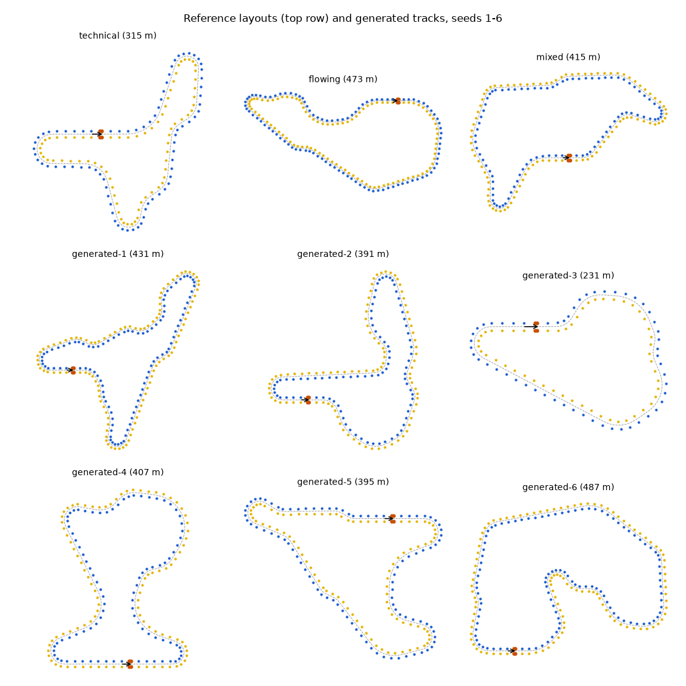

# Simulator (`apex::sim`)

The world the car races in: trackdrive circuits marked by cones, a dynamic model of the car, the
sensors it carries, and the officials who time it and hand out penalties. Everything here is
ground truth; the car's software sees it only through sensor messages (docs/design.md, sections 2
and 5.1). This document explains how each part works, where its numbers come from, and how well
it matches its references. Measured results are in [`results/sim/`](../results/sim/README.md).

| Part | Header | Source |
|---|---|---|
| Track generator, reference layouts | `sim/track_gen.hpp` | `track_gen.cpp`, `track_layout.*`, `reference_tracks.cpp` |
| Track rules and analysis | `sim/track_rules.hpp` | `track_rules.cpp`, `track_profile.hpp` |
| Vehicle model | `sim/vehicle_model.hpp` | `vehicle_model.cpp` |
| Sensors | `sim/sensors.hpp`, `sim/lidar.hpp` | `vehicle_sensors.cpp`, `lidar.cpp`, `camera.cpp`, `sensor_noise.cpp` |
| Race officials | `sim/race.hpp` | `race.cpp` |
| World | `sim/world.hpp` | `world.cpp` |
| Config JSON | `sim/config_json.hpp` | `config_json.cpp` |

Using it takes no setup:

```cpp
apex::sim::World world(apex::sim::generate_track(seed), apex::sim::WorldConfig{});
world.command({world.time(), steer, accel});           // queued; actuators respond after dead time
for (const apex::SensorMessage& m : world.step()) ...   // 1 ms tick
world.truth(); world.race().laps();                     // ground truth and timing
```

Tests of the car's modules can also call the sensor models directly (`simulate_lidar`,
`simulate_camera`, `simulate_imu`, ...): each is a pure function of its inputs and its `Rng`.

## Tracks

### Rules

A trackdrive circuit must satisfy the FS Driverless rules (closed loop, cones blue on the left and
yellow on the right, straights up to 80 m, a mix of hairpins, chicanes and constant turns),
tightened to the apex limits of docs/design.md, section 5.1. `TrackRules` holds them and
`check_track_rules` checks them on the sampled centerline; `validate_track` (core) checks the
rest (simple boundaries, cone spacing).

| Rule | Value | How it is measured |
|---|---|---|
| Centerline length | 200-500 m | arc length |
| Track width | 3.5 m | cone line to cone line (`TrackBuildOptions::half_width` 1.75 m) |
| Minimum radius | 6 m | smallest centerline radius of curvature |
| Longest straight | 80 m | longest run with curvature below 0.02 1/m (a 50 m radius is flat out) |
| Clearance | 4 m | smallest gap between the cone lines of two centerline points more than 20 m apart along the track |
| Features | at least one hairpin, chicane and sweeper | turns are maximal runs of same-signed curvature; a *hairpin* turns 130 degrees or more at a radius of 10 m or less, a *chicane* is two opposite turns of 15-100 degrees within 10 m, a *sweeper* turns 30 degrees or more at a radius of 14 m or more throughout |

The 20 m adjacency length exceeds the half circle of a 6 m hairpin (18.8 m), so the two legs of
a hairpin must keep their 4 m of clearance: the generator cannot cheat with a hairpin that
folds the track back onto itself.

### Generator

`generate_track(seed)` draws candidates until one meets every rule, all randomness from
`Rng(seed)`:

1. **Features.** A hairpin (150-190 degrees at 6.5-9 m), a chicane (two opposite 30-60 degree
   turns at 8-14 m, 0.5-4 m apart) and a sweeper (40-100 degrees at 15-25 m) are always drawn;
   more features (hairpins, medium corners of 40-110 degrees at 8-15 m, sweepers, chicanes, with
   weights 0.20/0.35/0.25/0.20) are added until the estimated length reaches a target drawn in
   the middle 80% of the length range. They are shuffled and joined by straights of 5-30 m, with
   a start straight before and after the timekeeping line.
2. **Curvature profile.** Each turn is an arc entered and left through clothoids (curvature
   linear in arc length), the way road and railway alignments are laid out. A cubic spline fitted
   through an arc that starts abruptly overshoots its curvature: core's oval, which has no
   transitions, measures a 10.5 m minimum radius on 12 m arcs. With clothoids the spline
   reproduces the designed radii to well under 1%.
3. **Heading closure.** The turns that may scale (corners and sweepers) are scaled by one factor
   in [0.6, 1.6] so the total turning is exactly +/-360 degrees; if no factor fits, a random
   turn is flipped and the scaling retried.
4. **Position closure.** With the heading closed, the end point is linear in the straights'
   lengths, so closing the loop is the least-norm change of those lengths that moves the end to
   the origin, within each straight's bounds: a box-constrained least-squares problem. Its
   Lagrangian dual has only two variables (the closure error's components); the layout solves it
   by semi-smooth Newton ascent with backtracking (Boyd and Vandenberghe, *Convex Optimization*,
   Cambridge University Press, 2004, chapter 5), converging in a few steps or proving that no
   solution exists.
5. **Checks.** The exact layout is sampled every meter and checked against the rules with 0.3 m
   of margin on radius and clearance; survivors go through `track_from_centerline` (core), which
   places the cones and the four big orange cones, and the built track is checked again.

Rejection and retry keeps the generator simple and its output deterministic; a repair step
(nudging a failing candidate until it passes) would be faster but would correlate the tracks
with the repair. Over seeds 1-200 a track takes 14.0 candidates on average and every one of the
200 passes `validate_track` and every rule (`TrackGenSeeds` test). A generated track is 379 m
long on average, with 1.76 hairpins, 2.02 chicanes, 2.77 sweepers and 1.93 other corners.
Generation takes 4-5 ms per track (dev build, quiet machine).

### Reference layouts

`reference_track(name)` returns three fixed circuits for repeatable experiments. They were drawn
by the generator with weights favouring their character and frozen as element lists, so changes
to the generator never move them.

| Name | Length | Min radius | Longest straight | Clearance | Hairpins | Chicanes | Sweepers | Corners |
|---|---|---|---|---|---|---|---|---|
| `technical` | 315 m | 6.42 m | 26.5 m | 8.35 m | 3 | 2 | 1 | 1 |
| `flowing` | 473 m | 7.01 m | 61.0 m | 10.80 m | 1 | 1 | 8 | 2 |
| `mixed` | 415 m | 6.83 m | 39.0 m | 10.47 m | 2 | 1 | 3 | 4 |



Reproduce the figure with
`./build/release/bench/sim/apex_export_tracks build/tracks` and
`uv run --project tools python tools/sim/plot_tracks.py build/tracks docs/img/sim-tracks.png`.

## Vehicle model

### Equations

A dynamic single-track (bicycle) model at the center of gravity (Rajamani, *Vehicle Dynamics and
Control*, Springer, 2nd ed., 2012, chapters 2-3), with states x, y, yaw, vx, vy, r and the two
actuator states, front wheel angle d and total longitudinal force F:

```
m (vx' - vy r) = Fxf cos d - Fyf sin d + Fxr - F_drag - F_roll
m (vy' + vx r) = Fxf sin d + Fyf cos d + Fyr
Iz r'          = lf (Fxf sin d + Fyf cos d) - lr Fyr
```

- **Lateral tire force** per axle from the simplified magic formula (Pacejka, *Tire and Vehicle
  Dynamics*, Butterworth-Heinemann, 3rd ed., 2012) of `TireParams`,
  `Fy = -mu Fz sin(C atan(B a - E (B a - atan(B a))))`, at slip angles
  `af = atan2(vy + lf r, vx) - d` and `ar = atan2(vy - lr r, vx)`.
- **Combined slip**: the friction ellipse leaves `sqrt(1 - (Fx / (mu Fz))^2)` of an axle's
  lateral force once it carries the longitudinal force Fx.
- **Normal loads**: static weight split by lr/L and lf/L, downforce `rho ClA v^2 / 2` split by
  `aero_balance_front`, and longitudinal load transfer `h (Fxf + Fxr) / L`. Drag is taken to act
  at the CoG height, so it transfers no load. The transfer depends on the traction-limited
  forces, which depend on the loads; one fixed-point pass settles it.
- **Longitudinal force**: the actuator force F, limited by the motors to `max_power / vx` and to
  `max_drive_force`, tapering to zero over the last 1 m/s below `max_speed`, split by
  `drive_split_front` (driving) or `brake_split_front` (braking), and each axle limited to
  `mu Fz` (traction).
- **Resistance**: `F_drag = rho CdA vx^2 / 2`, `F_roll = c_rr (m g + downforce)`.

The IMU reads `ax = vx' - vy r`, `ay = vy' + vx r`, stored in `VehicleState::ax, ay` after every
step.

**Low speed.** Slip angles are ill-defined near standstill and the equations become stiff, so
below 3 m/s the velocity derivatives blend linearly (down to 1.5 m/s, purely kinematic below)
into those of the kinematic bicycle, `vy = lr tan(d) vx / L`, `r = tan(d) vx / L`, as in Kabzan
et al., "AMZ Driverless: The full autonomous racing system", *Journal of Field Robotics* 37(7),
2020. A relaxation term (50 ms) pulls vy and r onto those constraints, so a car that slows while
sliding comes to rest instead of spinning on the spot.

**No reverse.** vx is clamped at zero, and at rest brakes and rolling resistance act as static
friction: they hold the car, never push it backwards, and a drive force smaller than the rolling
resistance does not make it creep. An IMU at rest reads exactly zero.

**Actuators.** Each command is queued and takes effect after the dead time (steering 30 ms,
drive 20 ms), at the start of the first step at or after its due time. Steering then follows a
first-order lag (30 ms) towards the target clamped to +/-0.40 rad, at most 1.5 rad/s; the drive
follows a first-order lag (50 ms) towards `accel * m`, clamped to [-5000, 3000] N. Non-finite
command fields are ignored, keeping the previous target.

**Integration.** Classic fourth-order Runge-Kutta at the World's 1 ms tick, actuator targets held
over the step. A non-finite result (never observed; a property test drives random commands
through 160 s of hard launches, braking and spins) stops the car and is counted in
`recoveries()`.

### Parameters

The parameters are core's `VehicleParams` (docs/design.md, section 4.2): a representative FS
electric car rather than a specific team's.

| Parameter | Value | Note |
|---|---|---|
| Mass, yaw inertia | 240 kg, 130 kg m^2 | car without driver, with the autonomous system |
| lf, lr, CoG height | 0.80 m, 0.75 m, 0.27 m | 1.55 m wheelbase, 48% of the weight on the front axle |
| Tires | B = 12, C = 1.45, E = 0, mu = 1.6 | peak near 8.8 degrees of slip; cornering stiffness `B C mu Fz` = 31.7 kN/rad front, 33.8 kN/rad rear at rest |
| Aero | CdA 1.40 m^2, ClA 3.50 m^2, 45% front | 840 N of downforce at 20 m/s |
| Rolling resistance | 0.015 | |
| Powertrain | 80 kW, 3000 N, 40% front | 80 kW is the FS rules' power limit; power-limited above 26.7 m/s |
| Brakes | 5000 N, 60% front | the tires saturate first |
| Top speed | 30 m/s | gearing |
| Steering | 0.40 rad, 1.5 rad/s, 30 ms lag, 30 ms dead time | |
| Drive | 50 ms lag, 20 ms dead time | |

With these values the car is almost exactly neutral: the understeer gradient
`K = (m / L) (lr / Cf - lf / Cr)` is 2.5e-5 to 9.6e-5 rad per m/s^2 between 8 and 20 m/s.

### Validation

`./build/release/bench/sim/apex_vehicle_validation` reports each comparison
([`results/sim/vehicle_validation.json`](../results/sim/vehicle_validation.json));
`tests/sim/vehicle_model_test.cpp` asserts it.

| Check | Reference | Result |
|---|---|---|
| Path curvature at 1 and 2 m/s, steer 0.1-0.4 rad | kinematic bicycle, `tan(d) cos(beta) / L` | 0.07% max error |
| Steady-state yaw rate at 2 m/s^2, 8-20 m/s, on the default car and on understeering (front B = 6, K = 3.5e-3) and oversteering (rear B = 8, K = -1.7e-3) variants | linear single-track `r = v d / (L + K v^2)` with `C = B C mu Fz` and Fz from weight and downforce | 0.19% max error (limit 2%) |
| Coast-down from 25 m/s over 40 s | `v(t) = sqrt(a/b) tan(atan(v0 sqrt(b/a)) - sqrt(ab) t / m)` with `a = c_rr m g`, `b = rho (CdA + c_rr ClA) / 2` | 8.5e-14 m/s, 1.7e-12 m |
| Full throttle at 14-26 m/s with 40 kW | `(P / v - drag - rolling) / m` | 2.7e-15 m/s^2 |
| Peak lateral acceleration in a turn tightened at 0.05 rad/s at constant speed | `mu (g + downforce / m)` | 0.902, 0.902, 0.885 of it at 10, 15, 20 m/s; 0.947, 0.929, 0.903 at half friction; never above |
| Halving the step twice on a 5 s weave | RK4 converges at order 4 | changes 8.0e-10 then 4.9e-11: order 4.04 |

The peak lateral acceleration falls short of the friction limit by design, not error: the front
axle saturates first (the car understeers at the limit), and the drive force that holds the speed
against drag and cornering drag both uses some of the friction ellipse and moves load off the
front axle.

### Simplifications

- One track: no lateral load transfer, no roll; both wheels of an axle share one force.
- No tire relaxation length and no wheel rotational dynamics; the longitudinal slip appears only
  in the wheel speed sensors.
- Flat ground; drag acts at the CoG height; no wind.
- In a spin past 90 degrees the clamp on vx removes the backward slide: a run is lost by then
  anyway, and the model only has to stay finite.

## Sensors

Every sensor fires on the World ticks its rate divides (IMU 200 Hz, wheel speeds and steering
100 Hz, camera 20 Hz, LiDAR 10 Hz), stamps the tick's time, and draws from its own `Rng` stream
split from the world seed, so changing one sensor's noise never changes another's measurements.
The noise defaults below are `SensorNoise`'s; `scale_noise(noise, k)` multiplies every standard
deviation and bias by k and leaves probabilities, rates and physical properties alone, for the
noise ablations. All of it reads from and writes to JSON (`sim/config_json.hpp`).

### IMU

`simulate_imu` returns the body-frame specific force at the CoG, which on flat ground is the
state's `ax, ay`, and the yaw rate, each plus a bias and white noise. A test checks the noise-free
reading against a central difference of the world-frame velocity rotated into the body frame:
they agree to 5 mm/s^2 wherever the motion is smooth.

| Parameter | Default | Basis |
|---|---|---|
| Accelerometer white noise | 0.05 m/s^2 per sample | industrial MEMS IMUs (Xsens MTi-600 series, VectorNav VN-100) specify noise densities of 60-140 ug/sqrt(Hz), 0.006-0.014 m/s^2 at 200 Hz; on a car, chassis vibration dominates |
| Gyroscope white noise | 0.002 rad/s per sample | 0.004-0.007 deg/s/sqrt(Hz) in the same datasheets, 0.0006-0.0012 rad/s, plus vibration |
| Turn-on bias (1 sigma) | 0.02 m/s^2, 0.002 rad/s | drawn once per run; 0.002 rad/s is 7 degrees of heading per minute uncorrected, which the estimator must estimate |
| Bias random walk | 0.002 m/s^2/sqrt(s), 5e-5 rad/s/sqrt(s) | 1 sigma drift of 9e-4 rad/s over a 5 minute run |

### Wheel speeds and steering

`simulate_wheel_speeds` returns each axle's circumferential speed: the ground speed of the axle
center along its wheels (`vx cos d + (vy + lf r) sin d` at the front, `vx` at the rear; the
left-right difference from yaw cancels in the axle average) times `1 + Fx / (k Fz)` for that
axle's longitudinal force, plus 0.05 m/s of noise, never negative. The slip stiffness k = 20
puts a slick at its peak friction (mu 1.6) near 8% slip, in line with the 5-15% at which racing
tires peak (Milliken and Milliken, *Race Car Vehicle Dynamics*, SAE, 1995). Under full braking the
front wheels read 3% and more below the ground speed, which is what an estimator that trusts the
wheels blindly gets wrong.

`simulate_steering` returns the actual front wheel angle (after the actuator) plus 0.002 rad
(0.11 degrees) of noise, the play between column and wheels included.

### LiDAR

The geometry is core's `LidarGeometry`: 64 channels from -12 to +4 degrees, 0.2 degree azimuth
steps over +/-90 degrees (57,664 rays), 0.3-50 m, mounted 1.2 m ahead of the CoG and 0.2 m above
the ground on the front wing.

**Ray casting.** Each ray is intersected with the ground plane and with every candidate cone, a
right circular cone of `cone_shape` standing on the ground; the nearest hit within range is the
return, so cones shadow the ground and each other. For a cone with apex `(cx, cy, H)` and
`k = R / H`, points on the surface satisfy `(x - cx)^2 + (y - cy)^2 = k^2 (z - H)^2` with
`0 <= z <= H`; substituting the ray gives a quadratic in t, solved in the cancellation-free form
of Press et al., *Numerical Recipes*, 3rd ed., 2007, section 5.6, discarding roots on the upper
nappe or below the ground (`intersect_cone`, `sim/lidar.hpp`).

**Culling.** Testing every ray against every cone of a 150-200-cone track costs 62 ms per scan. The
scan instead lists, for each azimuth column, the cones whose angular half-width `asin(R / d)`
around their bearing covers it (compressed rows, nearest cone first), and skips a cone for a
channel outside the cone's elevation bounds. A ray stops testing cones once the next one's base
circle is farther than its best hit. All bounds are conservative, so culling never changes a
return: `simulate_lidar` is tested to be bit-identical to `simulate_lidar_brute_force` (every ray
against every cone) from poses around two tracks, on a 360 degree scan whose columns wrap around
the back, and with the sensor standing over a cone's base.

**Noise.** Each return is dropped with probability 2% (dark, wet or grazing surfaces) and
otherwise gets Gaussian range noise of 2 cm along its ray, the range precision 64-channel
automotive LiDARs specify (Velodyne HDL-64E, Hesai Pandar64). Points are in the LiDAR frame
(ground at z = -0.2 m) with the cone's `truth_id`, -1 for ground.

A scan from the track has about 41,700 returns, of which about 1,000 are on cones: perception's
ground removal has most of the work.

### Camera

The camera (core's `CameraGeometry`: on the main hoop 1.1 m up, 100 degree field of view, 30 m)
is modelled as the output of a cone detector, a single-stage CNN of the kind FS teams run (Strobel
et al., "Accurate, Low-Latency Visual Perception for Autonomous Racing: Challenges, Mechanisms,
and Practical Solutions", IROS 2020, describe one such pipeline), not as pixels:

1. **Candidates**: cones in the field of view, 2-30 m away (closer ones are hidden below the
   car's nose), unless the sight line from the camera to the middle of the cone's body passes
   through another cone (a ray-cone test with `intersect_cone`). From 1.1 m up, a cone hides
   another only when nearly in line and close in front of it: one 18 m away hides one at 20 m on
   the same bearing; one 10 m away does not.
2. **Detection** with probability `p(r) = 0.98 / (1 + exp((r - 22 m) / 3 m))`: 96% at 10 m, 49% at
   22 m, 12% at 28 m.
3. **Measurements**: bearing noise 0.003 rad (about 3 pixels); range noise `0.05 m + 0.0015 r^2`
   (0.2 m at 10 m, 0.65 m at 20 m), growing as `r^2` because range comes from a cone's apparent
   size, whose pixel height goes as `1 / r`; a wrong color with probability rising linearly from
   1% at 0 m to 10% at 30 m, where cones are a few pixels tall; a score `p(r)` plus 0.05 of noise.
4. **False positives**: a Poisson number (mean 0.3 per frame) spread uniformly over the field of
   view and range, with scores of 0.1-0.6 and `truth_id` -1.

Detections are sorted by bearing, as a detector lists them across the image, so their order says
nothing about which are false. These defaults are modelling choices, set so that colors are
reliable to about 15 m and detection fades out by about 28 m; the camera tests check the
simulated statistics against these formulas over 4,000 frames.

## Race officials

`RaceMonitor` applies the FS trackdrive scoring from the truth after every tick:

- **Laps** are timed by a light barrier on the timekeeping line, between the big orange cones
  (widened by half the body width), tripped by the CoG and interpolated within the tick. It
  counts *net* crossings: crossing backwards cancels the last forward crossing, so a car hovering
  on the line starts and finishes each lap once.
- **Cones** are knocked when the body footprint (a rectangle 1.60 m ahead of the CoG, 1.30 m
  behind, 1.40 m wide) overlaps a cone's base circle; 2 s each, counted once per cone. Knocked
  cones stay where they are for the sensors.
- **Off course** is all four wheel contact points outside the cone lines; 10 s per excursion,
  which ends when the CoG is back between the lines.
- **Progress** is the distance driven along the centerline since the first crossing (negative
  before it), accumulated from the projection of the CoG, which is searched within 10 m of the
  previous one so that it never jumps to a nearby part of the track.

## World

`World` owns the track, the vehicle model, the sensors' `Rng` streams and the race monitor. A tick
steps the vehicle 1 ms, updates the race, and returns the messages stamped at the new time in a
fixed order: IMU, wheel speeds, steering, camera, LiDAR. The constructor throws
`std::invalid_argument` for a sensor rate that does not divide 1 kHz, invalid vehicle parameters,
noise or sensor geometry, a friction scale that is not positive, or cone ids that are not their
indices. Two Worlds with the same track, config and commands produce bit-identical messages
(tested over 4 s of driving with every sensor).

## Performance

Release build, Apple M4, one core; `./build/release/bench/sim/apex_sim_bench`
([`results/sim/bench.json`](../results/sim/bench.json)). The machine was shared (load average
~130 on 10 cores) when these were recorded, so the medians are the reliable figures.

| Work | Result |
|---|---|
| LiDAR scan, 57,664 rays, 245 poses on three tracks | p50 1.54 ms, p90 2.70 ms (budget: well under 5 ms) |
| The same scans without culling | p50 62 ms; culling is 42x faster on average |
| Camera frame | p50 15 us, 9.7 detections |
| Vehicle model step | 1.2 us |
| World, a 45.7 s lap of `generated-1` with every sensor | 1.07 s wall: 42.7x real time (target 10x); tick p50 3.0 us, p99 1.09 ms (the LiDAR ticks) |

The LiDAR is about 85% of the World's cost (a mean tick of 22.3 us, against 3 us for a tick with
only the physics, the race monitor and the IMU, wheel and steering models).

## Limitations

- Knocked cones are not displaced; the sensors keep seeing them where they stood.
- The LiDAR scan is instantaneous at its stamp (no motion distortion within a revolution), has
  no beam divergence or intensity, and sees the cone bodies but not their square base plates.
- The camera is a detector model: no lighting, motion blur or image-level failure modes, and
  occlusion is decided by one sight line per cone.
- The vehicle model is single-track (see Simplifications above); the track is flat.
